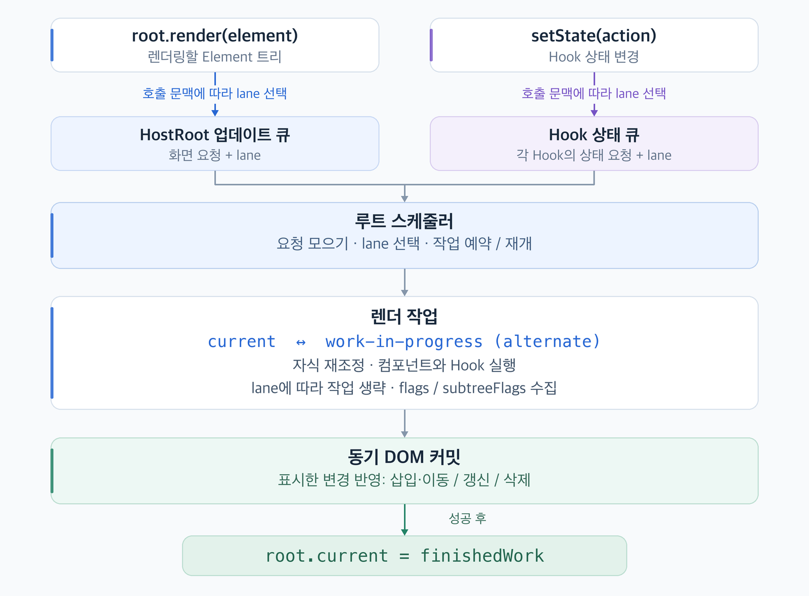
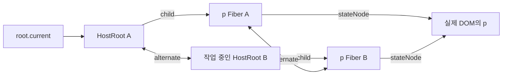
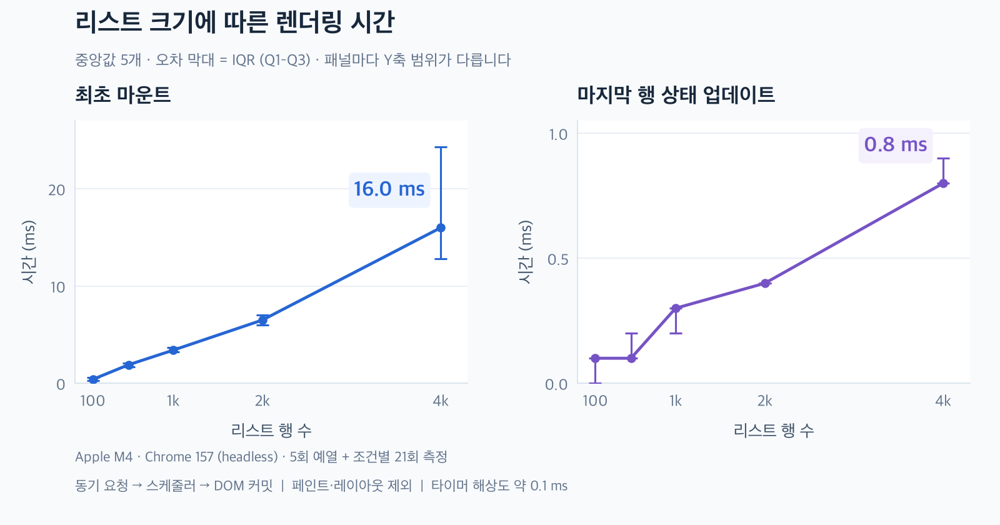

# Reactify v2

Reactify는 함수 컴포넌트와 `useState`로 브라우저 화면을 만드는 TypeScript UI 렌더러입니다. `createElement`로 화면을 기술하면 Fiber가 이전 화면과 비교하고, 렌더러가 바뀐 부분을 DOM에 반영합니다. 런타임 의존성은 없습니다.

[빠른 시작](#빠른-시작) · [렌더링 구조](#렌더링-구조) · [API](#api) · [벤치마크](#벤치마크) · [지원 범위](#지원-범위)

## 빠른 시작

Node.js 22 이상에서 저장소의 `CatIsApple/` 디렉터리로 이동해 빌드합니다.

```sh
npm ci
npm run build
```

같은 디렉터리에 아래 내용을 `quickstart.html`로 저장합니다. 입력창은 브라우저가 관리하고, Reactify는 `<main>` 안의 인사말을 관리합니다.

```html
<!doctype html>
<html lang="ko">
<meta charset="utf-8">
<title>Reactify 인사말</title>
<label>이름 <input id="name" value="다온"></label>
<main id="app"></main>

<script type="module">
  import { createElement as h, createRoot } from './dist/index.js';

  const input = document.querySelector('#name');
  const root = createRoot(document.querySelector('#app'));

  function Greeting({ name }) {
    return h('p', null, `안녕하세요, ${name || '친구'}님!`);
  }

  function renderGreeting() {
    root.render(h(Greeting, { name: input.value }));
  }

  input.addEventListener('input', renderGreeting);
  renderGreeting();
</script>
</html>
```

`python3 -m http.server 8000`을 실행하고 브라우저에서 `http://localhost:8000/quickstart.html`을 엽니다. 이름을 바꾸면 기존 `<p>`와 텍스트 노드를 유지하면서 인사말이 바뀝니다. `root.render()`는 갱신을 예약하므로 호출 직후에는 이전 DOM이 보일 수 있습니다.

## 렌더링 구조



| 단계 | Reactify가 하는 일 |
| --- | --- |
| Element | `createElement(type, props, ...children)`가 `{ type, key, props }`를 만듭니다. 이때는 함수 컴포넌트를 호출하거나 DOM을 생성하지 않습니다. |
| Render | `root.current`는 화면에 반영된 트리를 가리킵니다. 렌더는 작업용 Fiber를 `child → sibling → return` 링크로 순회합니다. 재사용하는 Fiber는 `alternate`로 이전 버전과 연결되며 기존 DOM 노드를 공유합니다. |
| Reconcile | 같은 부모 아래에서 단일 Element는 첫 번째로 key가 일치하는 기존 형제의 type을 확인합니다. 목록은 앞에서부터 비교하다 key가 어긋나면 나머지 형제를 Map으로 찾습니다. 같은 key와 type을 유지한 항목은 위치가 바뀌어도 상태와 DOM을 재사용할 수 있습니다. |
| Commit | 새 DOM은 렌더 중 문서 밖에서 준비합니다. 커밋은 `subtreeFlags`로 변경이 있는 가지를 찾아 삽입·이동(`Placement`), 속성·텍스트 갱신(`Update`), 부모가 기록한 삭제(`ChildDeletion`과 `deletions`)를 동기로 적용합니다. 반영에 성공하면 `root.current`를 교체합니다. |

<details>
<summary>같은 &lt;p&gt;를 다시 렌더링할 때 두 Fiber가 가리키는 곳</summary>

`root.render(h('p', null, 'A'))`가 커밋된 뒤, 같은 자리에 `'B'`를 렌더링하는 중입니다. 두 호스트 Fiber의 `stateNode`는 화면에 있는 동일한 문단을 가리킵니다.



커밋은 문단 안의 기존 텍스트 노드를 `'B'`로 갱신한 뒤 `root.current`가 HostRoot B를 가리키게 합니다.

</details>

### Counter 하나를 갱신하면

`App` 아래에 `Header`와 `Counter`가 있고, `Counter`만 `setCount(n => n + 1)`을 호출했다고 가정합니다.

1. setter가 해당 Hook의 큐에 갱신을 넣습니다. `Counter.lanes`에는 자신의 작업이, 조상의 `childLanes`에는 아래로 내려가야 할 경로가 표시됩니다.
2. 루트에서 순회를 시작합니다. props 참조가 같은 `App`은 함수 호출을 생략하고 자식으로 내려갑니다. `Header`에는 대기 중인 작업이 없어 그 가지를 건너뜁니다. 이 생략이 **bailout**입니다.
3. `Counter`가 새 상태로 다시 호출됩니다. 표시한 숫자만 달라졌다면 커밋은 기존 텍스트 노드의 값만 바꿉니다.

[Hook 큐와 setter](src/fiber/hooks.ts) · [Fiber 작업 루프와 bailout](src/fiber/workLoop.ts) · [DOM 커밋](src/dom/commitWork.ts)

### HostRoot의 업데이트 큐와 스케줄링

`root.render(element)`는 다음 화면을 HostRoot 큐에 넣고, `setState(action)`은 함수 Fiber의 Hook 큐에 상태 갱신을 넣습니다. 두 경로는 한 루트 스케줄러를 사용합니다. **lane**은 각 요청의 우선순위를 나타내는 비트입니다. 스케줄러는 대기 요청을 마이크로태스크에 모아 어느 lane을 먼저 처리할지 정합니다.

| 호출 문맥 | 렌더 실행 방식 |
| --- | --- |
| 클릭·키 입력 등 이산 이벤트 | Sync lane으로 예약하고 마이크로태스크에서 처리합니다. |
| 포인터 이동·스크롤, 일반 코드의 갱신 | 연속 입력과 일반 갱신에는 각각 별도 lane을 배정합니다. 둘 다 렌더를 시작하면 양보 없이 마칩니다. |
| `startTransition(() => root.render(next))` 또는 idle 우선순위 | 미완성 렌더는 Fiber 사이에서 브라우저에 실행권을 돌려줄 수 있습니다. 스케줄러의 기본 시간 예산은 5ms입니다. 같은 작업은 저장한 Fiber부터 이어가며, 더 급한 입력이 들어오면 우선순위를 다시 판단합니다. |

양보는 렌더 작업 단위 사이에서 일어납니다. 실행 중인 컴포넌트 함수 하나가 오래 걸리면 그 함수가 반환할 때까지 기다립니다. [lane 선택](src/fiber/lanes.ts) · [루트 스케줄러](src/fiber/rootScheduler.ts) · [브라우저 작업 예약](src/scheduler/scheduler.ts)

## API

브라우저에서는 빌드된 `dist/index.js`의 ES 모듈을 가져옵니다. [공개 진입점](src/index.ts)

| API | 용도 |
| --- | --- |
| `createElement(type, props?, ...children)` | HTML 태그 또는 함수 컴포넌트의 Element를 만듭니다. 형제 목록에는 항목의 고유 ID를 `key`로 전달합니다. |
| `createRoot(container)` | DOM 컨테이너에 연결된 루트를 만듭니다. `root.render(children)`로 화면을 예약하고, `root.render(null)`로 내용을 비울 수 있습니다. |
| `useState(initial)` | 함수 컴포넌트 안에서 `[state, setState]`를 반환합니다. 초기화 함수와 이전 상태를 받는 updater를 지원합니다. Hook은 매 렌더에서 같은 순서로 호출합니다. |
| `startTransition(scope)` | 콜백 안에서 동기로 등록한 갱신에 전환 우선순위를 부여합니다. |
| `runWithPriority(priority, scope)` | 콜백 안에서 사용할 우선순위를 지정합니다. 예를 들어 `'sync'`는 갱신을 Sync lane에 예약합니다. |

렌더와 커밋을 따로 관찰하려면 `root.prepare(children)`로 동기 렌더를 마친 뒤 `root.finishedWork`를 확인합니다. 이때 컨테이너는 이전 화면을 유지합니다. `root.commit()`을 호출하면 준비한 변경이 보입니다. [루트 구현](src/fiber/root.ts)

## 벤치마크

**목록 전체를 처음 그리는 비용과, 이미 그린 목록에서 한 행의 숫자를 바꾸는 비용**을 측정했습니다. 각 행은 독립적인 `useState`와 고유 key를 가지며, `<li>` 안에 `<span>`과 `<strong>`을 렌더링합니다. 두 번째 측정에서는 마지막 행의 setter만 호출합니다.



| 행 수 | 최초 마운트 중앙값 | 마지막 행 상태 갱신 중앙값 |
| ---: | ---: | ---: |
| 100 | 0.4 ms | 0.1 ms |
| 500 | 1.9 ms | 0.1 ms |
| 1,000 | 3.4 ms | 0.3 ms |
| 2,000 | 6.5 ms | 0.4 ms |
| 4,000 | 16.0 ms | 0.8 ms |

4,000행에서 상태 갱신은 기존 마지막 행의 DOM을 재사용했습니다. 한 행의 텍스트만 바뀌어도 작업이 남은 자식을 찾는 과정에서 형제 Fiber를 순회하므로 목록 크기는 갱신 비용에도 영향을 줄 수 있습니다.

- **환경** — Apple M4, macOS 15.3.2, Chrome 157.0.8103.40 headless, 2026-11-10. 각 크기에서 5회 예열 후 새 루트로 21회 측정했습니다.
- **구간** — 두 작업 모두 Sync 우선순위로 요청한 시점부터 DOM 커밋 다음 마이크로태스크까지입니다. 매회 타이머 밖에서 행 수, 변경된 값, 기존 `<strong>`의 노드 동일성을 확인했습니다. 브라우저의 레이아웃과 페인트 완료 시간은 측정 범위 밖입니다.
- **읽는 법** — 그래프의 점은 중앙값, 범위는 가운데 50%의 측정값입니다. 두 패널은 세로축 범위가 다릅니다. 관찰된 타이머 해상도는 약 0.1 ms입니다. [전체 측정값과 환경](benchmarks/list-results.json) · [측정 코드](benchmarks/list.ts)

<details>
<summary>내 브라우저에서 재현하기</summary>

`CatIsApple/`에서 라이브러리와 측정 코드를 빌드한 뒤 정적 서버를 실행합니다.

```sh
npm run build
npx --no-install tsc --ignoreConfig benchmarks/list.ts --target ES2022 --module NodeNext --strict --outDir build
python3 -m http.server 8000
```

`http://localhost:8000/benchmarks/`를 열면 실행이 끝난 뒤 측정값이 JSON으로 표시됩니다. 빠른 시작에서 띄운 서버도 그대로 사용할 수 있습니다.

</details>

## 지원 범위

| 영역 | 현재 v2의 동작 |
| --- | --- |
| HTML과 자식 | HTML 요소, 문자열, 숫자, 중첩 배열을 렌더링합니다. `null`, `undefined`, 불리언 자식은 생략합니다. |
| 속성과 이벤트 | `className`, `htmlFor`, `data-*`, `aria-*`, 문자열 `style`을 지원합니다. 이벤트는 빠른 시작처럼 브라우저의 `addEventListener`로 연결합니다. `onClick` 같은 이벤트 props와 객체형 `style`은 전달하면 오류가 발생합니다. |
| 컴포넌트와 확장 범위 | 함수 컴포넌트마다 `useState`를 사용할 수 있습니다. 현재 공개 Hook은 `useState` 하나입니다. JSX 런타임, `ref`, SVG·MathML 렌더링은 미지원입니다. |

이 문서는 `Element → Fiber → DOM` 방식의 v2를 다룹니다. 팀 과제의 DOM 변환 및 상태 이력 요구사항은 공용 미션에서 확인할 수 있습니다. [팀 프로젝트](../README.md) · [프로젝트 미션](../MISSION.md) · [협업 가이드](../CONTRIBUTING.md)
