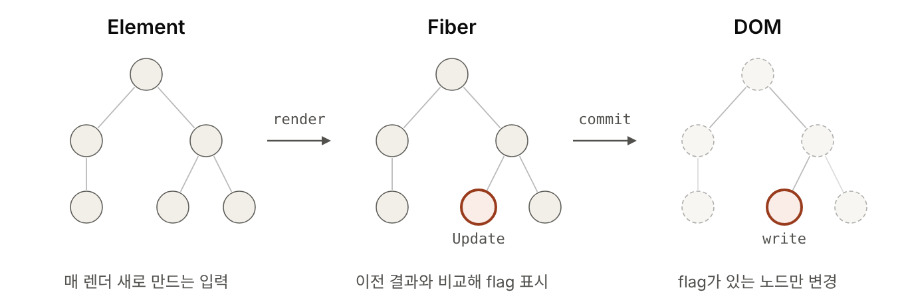
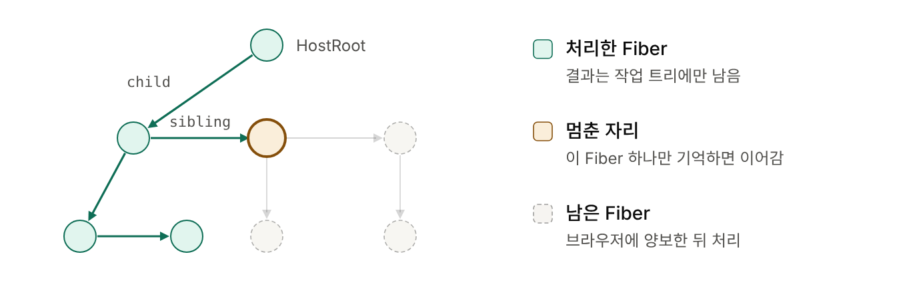
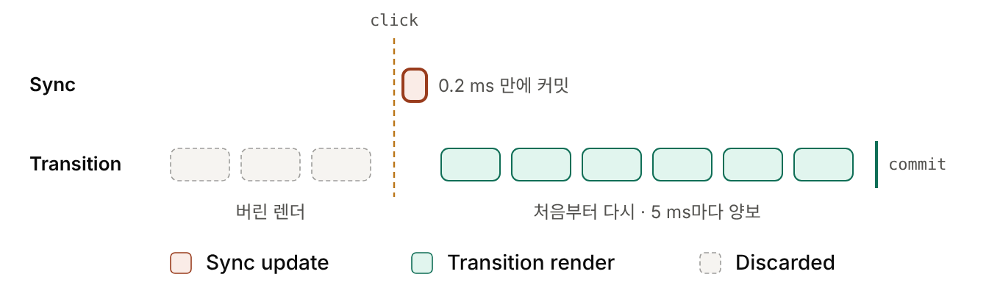
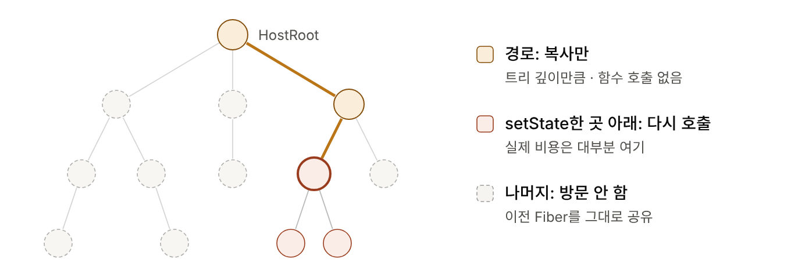
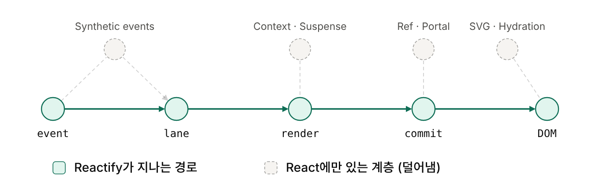
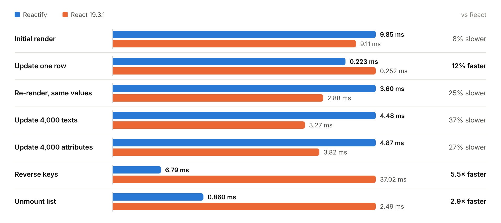
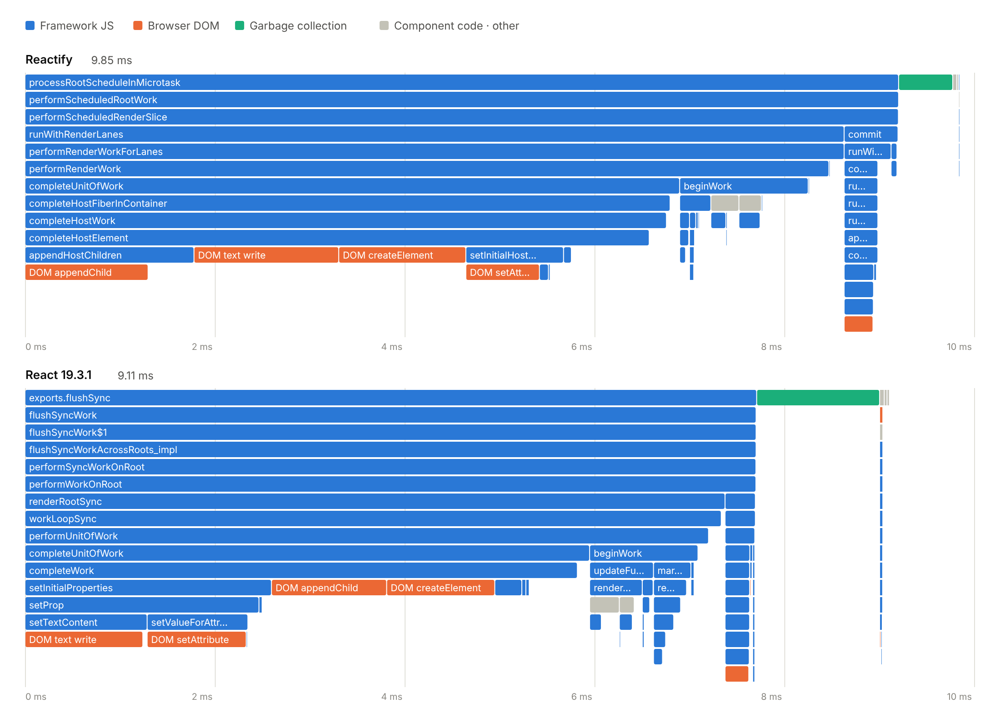
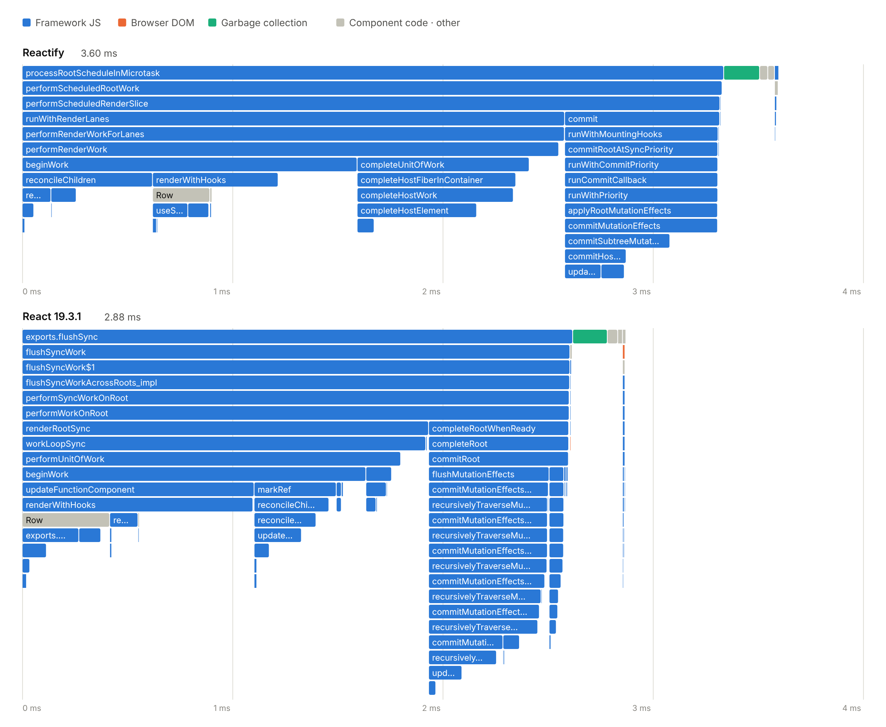

# Reactify
TypeScript로 Element → Fiber → DOM 렌더링부터 Lanes 스케줄링·Bailout·Hooks까지 직접 구현한 UI 프레임워크입니다.

TypeScript · Fiber · Lanes · Zero dependencies

> 과제 구조로 구현한 v1은 `feat/CatIsApple/v1` 브랜치에 있습니다.

## Quick Start

Node.js 22 이상에서 `CatIsApple/` 디렉터리의 명령을 실행합니다.

```sh
npm ci
npm run build
```

```js
import { createElement, createRoot } from './dist/index.js';

const root = createRoot(document.getElementById('app'));
root.render(createElement('h1', { className: 'title' }, 'Reactify'));
```

## New Changes

v1은 과제 구조대로 상태를 루트 컴포넌트에만 두고, 시작한 렌더를 끝까지 실행합니다. 이 구조에서는 아래 세 가지를 피할 수 없어 Fiber 구조를 도입했습니다.

- **Full re-run** — 한 곳만 바뀌어도 루트부터 전부 다시 실행합니다. → [Bailout](#bailout)
- **No interruption** — 큰 렌더가 끝날 때까지 입력이 막힙니다. → [Fiber Architecture](#fiber-architecture), [Lanes Scheduling](#lanes-scheduling)
- **Diff and patch in one pass** — 계산을 미루거나 버릴 수 없습니다. → [Element → Fiber → DOM](#element--fiber--dom)

### Element → Fiber → DOM

<picture>
  <source media="(prefers-color-scheme: dark)" srcset="assets/pipeline-dark.png">
  
</picture>

- **Why** — 비교(render)와 반영(commit)을 나눠야 렌더를 멈추거나 버릴 수 있습니다.
- **How** — Element는 매 렌더의 입력, Fiber는 비교하는 자리입니다. DOM은 flag가 붙은 노드만 바뀝니다.
- **Result** — 같은 값으로 4,000행을 다시 렌더하면 DOM 변경 **0건**입니다.

### Fiber Architecture

<picture>
  <source media="(prefers-color-scheme: dark)" srcset="assets/fiber-work-loop-dark.png">
  
</picture>

- **Why** — 재귀 호출은 중간에 멈출 수 없습니다.
- **How** — Fiber를 `child` · `sibling` · `return`으로 잇고 반복문으로 순회합니다. 화면과 일치하는 `current`는 그대로 두고 짝(`alternate`)에서만 계산합니다.
- **Result** — 멈춘 Fiber 하나만 기억하면 이어갈 수 있고, 렌더를 버려도 화면은 그대로입니다. 커밋 중 오류가 나면 역순으로 복구합니다.

[Fiber types](src/fiber/types.ts) · [Work loop](src/fiber/workLoop.ts) · [DOM commit](src/dom/commitWork.ts)

### Lanes Scheduling

<picture>
  <source media="(prefers-color-scheme: dark)" srcset="assets/lanes-dark.png">
  
</picture>

- **Why** — 모든 갱신을 같은 순서로 처리하면 큰 렌더가 클릭을 막습니다.
- **How** — 갱신마다 우선순위 비트(lane)를 붙입니다. `click` → Sync, `scroll` → InputContinuous, 그 외 → Default, `startTransition` → Transition(5 ms마다 양보).
- **Result** — 10,000행 마운트 중 최장 차단이 35.0 → **7.8 ms**로 줄었습니다. 도중에 넣은 Sync 갱신은 **0.2 ms** 만에 먼저 커밋됩니다.

[Lanes](src/fiber/lanes.ts) · [Root scheduler](src/fiber/rootScheduler.ts) · [Host scheduler](src/scheduler/scheduler.ts)

### Bailout

<picture>
  <source media="(prefers-color-scheme: dark)" srcset="assets/bailout-dark.png">
  
</picture>

- **Why** — 한 곳이 바뀔 때 전체를 다시 호출하는 것이 v1에서 가장 큰 비용입니다.
- **How** — `setState`가 자신의 Fiber와 조상의 `childLanes`에 lane을 표시합니다. 렌더는 표시된 경로만 복사하며 내려가고, 나머지는 이전 Fiber를 공유합니다.
- **Result** — 4,000행 중 한 행을 바꾸면 컴포넌트 호출이 4,000 → **1회**, 시간이 3.60 → **0.22 ms**입니다.

[Bailout](src/fiber/workLoop.ts) · [Child reconciler](src/fiber/childReconciler.ts) · [Hook queue](src/fiber/hooks.ts)

## Fewer Layers than React

<picture>
  <source media="(prefers-color-scheme: dark)" srcset="assets/layers-dark.png">
  
</picture>

- **Why** — React의 구조는 따르되, 이 과제에 쓰지 않는 계층은 크기와 실행 비용만 남깁니다.
- **Removed** — Synthetic events, Context, Suspense, ref · portal, SVG · hydration, 속성 종류별 전용 처리.
- **Result** — gzip **10.6 KB** (React 69.3 KB), 행당 JS 힙 **742 B** (867 B), 첫 렌더의 GC 비중 **6%** (14%). Reverse keys **5.5×**, Unmount list **2.9×**, Update one row **12%** faster.
- **Known gaps** — Initial render는 8%, 4,000행을 모두 다시 그리는 경로는 25–37% 느립니다.

## API

| API | Description |
| --- | --- |
| `createElement(type, props?, ...children)` | HTML 태그나 함수 컴포넌트의 Element를 만듭니다. |
| `createRoot(container)` | 루트를 만듭니다. `root.render(children)`으로 화면을 예약합니다. |
| `useState(initial)` | 컴포넌트별 `[state, setState]`를 반환합니다. |
| `useEffect(setup, deps?)` | 커밋 후 setup을 실행하고, 의존성이 바뀌거나 언마운트하면 cleanup을 실행합니다. |
| `useMemo(calculate, deps?)` | 의존성이 같으면 계산한 값을 재사용합니다. |
| `startTransition(scope)` | 콜백 안의 갱신에 전환 우선순위를 부여합니다. |
| `runWithPriority(priority, scope)` | 콜백 안의 갱신에 우선순위를 지정합니다. |

HTML 요소, 함수 컴포넌트, 문자열, 숫자, 중첩 배열을 렌더링합니다. 이벤트는 DOM의 `addEventListener`로 연결합니다. JSX 런타임, SVG, `ref`, `onClick` 같은 이벤트 props, 객체형 `style`은 지원하지 않습니다.

## Benchmark

4,000행 목록을 React 19.3.1과 같은 컴포넌트 코드로 측정했습니다. 렌더 요청부터 DOM 커밋 직후까지의 중앙값(ms)이며, 막대 길이는 경로마다 느린 쪽을 100%로 둔 상대 길이입니다.

<picture>
  <source media="(prefers-color-scheme: dark)" srcset="assets/bench-4000-rows-dark.png">
  
</picture>

- 한 부분만 바뀌는 경로(Update one row)와 구조가 바뀌는 경로(Reverse keys, Unmount list)는 React보다 빠릅니다.
- 4,000행을 모두 다시 계산하는 경로(Re-render, Update 4,000 texts · attributes)는 bailout이 적용되지 않아 React보다 느립니다.

### Flame Graph

**Initial render**의 CPU 프로파일입니다. 위에서 아래로 호출 순서이고, 폭은 한 번의 렌더에서 차지한 시간입니다.

<picture>
  <source media="(prefers-color-scheme: dark)" srcset="assets/flame-first-render-dark.png">
  
</picture>

- **Browser DOM** — 절반 이상이며 두 라이브러리가 같습니다(53%, 54%).
- **Garbage collection** — Reactify 6%, React 14%입니다.
- **Framework JS** — Reactify 39%, React 29%입니다. 호스트 요소를 완료하는 단계(`completeHostElement`)가 더 깁니다.

**Re-render, same values**의 프로파일입니다. DOM 변경이 없어 대부분이 Framework JS입니다.

<picture>
  <source media="(prefers-color-scheme: dark)" srcset="assets/flame-full-rerender-dark.png">
  
</picture>

- **Complete phase** — Reactify 26%, React 4%입니다. Reactify는 요소마다 태그를 검증하고 직접 텍스트를 확인합니다.
- **Commit phase** — 비중이 비슷합니다(17%, 18%).

### Size, Memory, Scheduling

| Metric | Reactify | React 19.3.1 |
| --- | ---: | ---: |
| Bundle size (minify + gzip) | **10.6 KB** | 69.3 KB |
| JS heap per row · 마운트 후 | **742 B** | 867 B |
| JS allocation · 전체 재렌더 1회 | 2.39 MB | **1.72 MB** |
| Longest block · 10,000행 Transition 마운트 | 7.8 ms | 6.6 ms |

Environment: Linux x64, Chrome 153 headless, 7세션의 중앙값, 소스 `9b85783953b8`.
