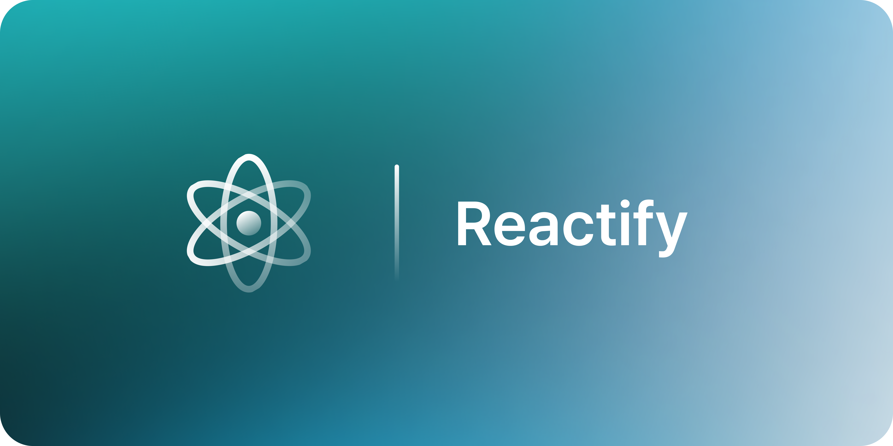
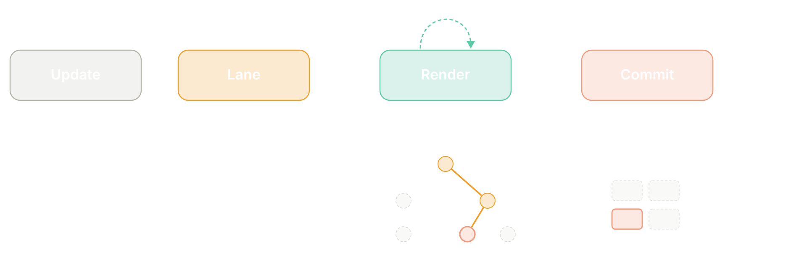
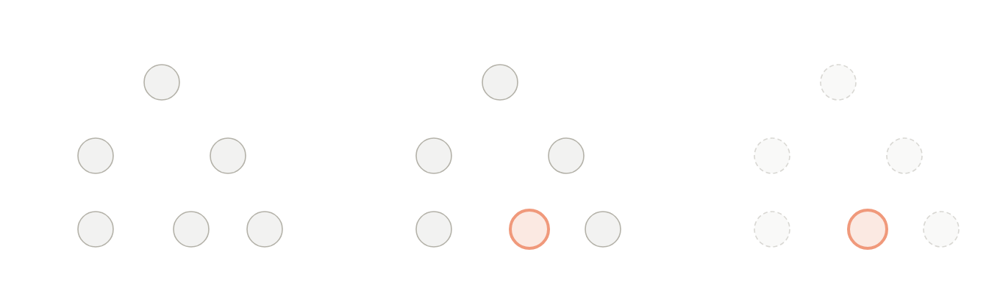
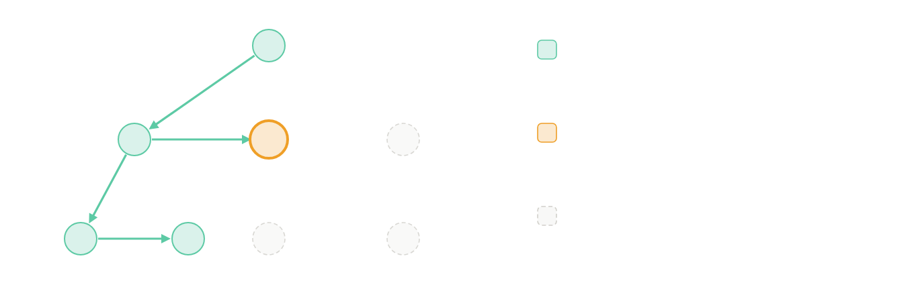
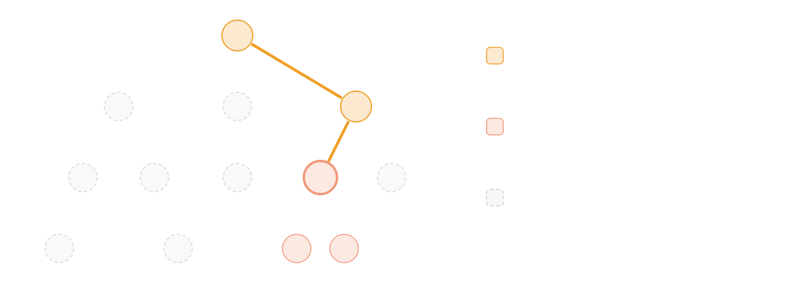
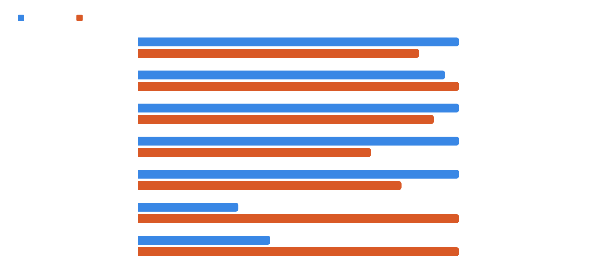
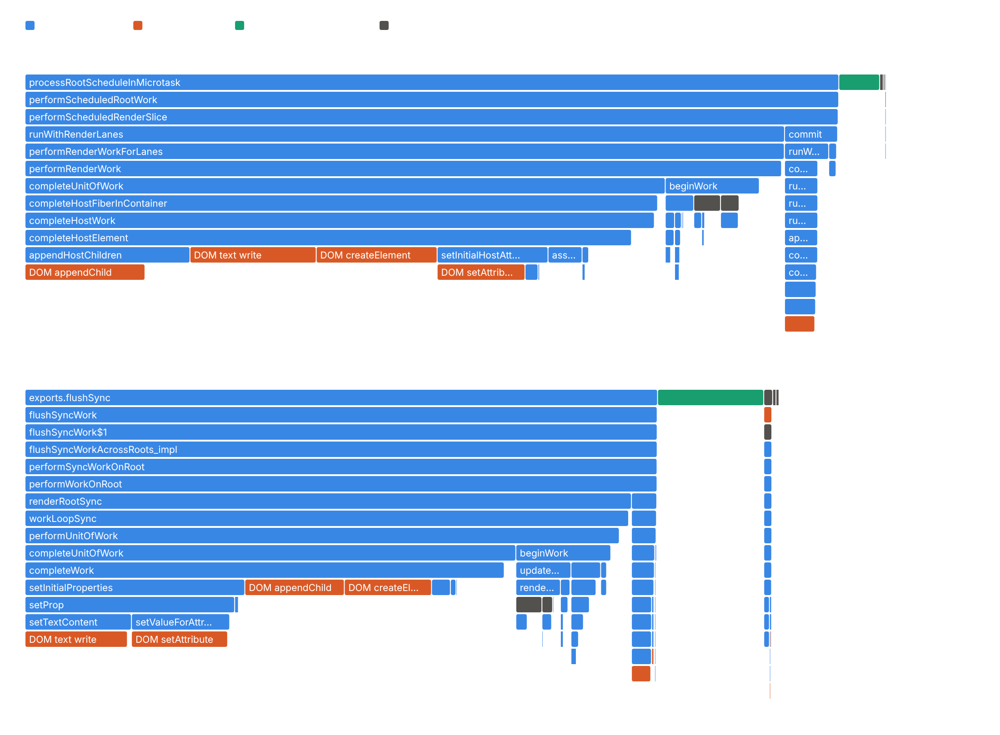
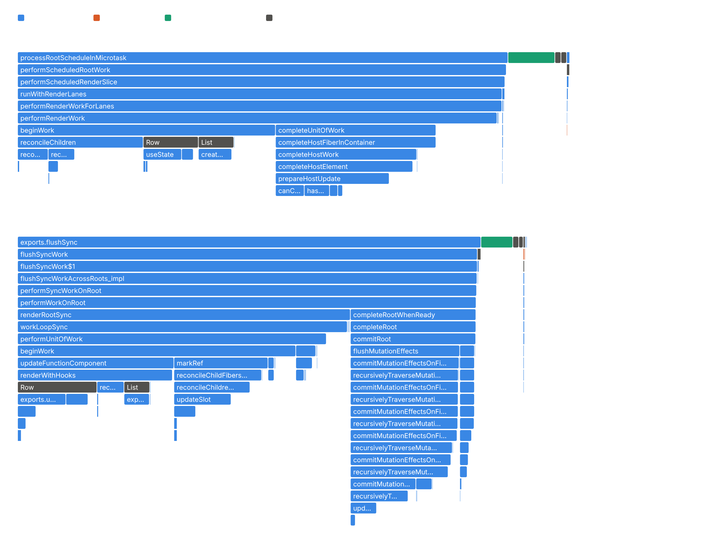

<div align="center">



# Reactify

### React의 Fiber 구조를 그대로, 필요한 것만 남긴 UI 프레임워크

**바뀐 곳만 다시 계산하고, 급한 갱신부터 처리하고, 비교가 끝난 변경만 DOM에 씁니다.**


[](#quick-start)
[](#how-reactify-works)
[](#architecture)
[](#benchmark)
[](#faq)

</div>

<br />

## Quick Start

Node.js 22 이상에서 이 디렉터리의 명령을 실행합니다.

```sh
npm ci
npm run build
```

`dist/index.js`를 ES 모듈로 불러옵니다.

```js
import { createElement as h, createRoot, useState, useEffect } from './dist/index.js';

function Counter() {
  const [count, setCount] = useState(0);

  useEffect(() => {
    const button = document.getElementById('plus');
    const onClick = () => setCount((c) => c + 1);
    button.addEventListener('click', onClick);
    return () => button.removeEventListener('click', onClick);
  }, []);

  return h('button', { id: 'plus' }, count);
}

createRoot(document.getElementById('app')).render(h(Counter));
```

<br />

## How Reactify Works



1. **Update** — `setState`와 `root.render`는 바로 그리지 않고 갱신을 큐에 넣습니다. 같은 이벤트 안의 갱신은 렌더 한 번으로 묶입니다.
2. **Lane** — 갱신마다 우선순위 비트를 붙입니다. 클릭은 Sync, `startTransition` 안의 갱신은 Transition입니다.
3. **Render** — Fiber 트리를 비교해 바뀐 노드에 flag만 남깁니다. 변경이 없는 가지는 건너뛰고, Transition 렌더는 5 ms마다 브라우저에 양보합니다.
4. **Commit** — flag가 붙은 노드만 DOM에 한 번에 반영합니다.

<br />

## Architecture

### Element → Fiber → DOM



Element는 매 렌더 새로 만드는 화면 설명입니다. Fiber는 이전 결과와 상태를 기억하는 작업 단위이고, DOM은 커밋할 때만 바뀝니다. 계산과 반영이 나뉘어 있어 렌더를 멈추거나 버려도 화면은 그대로입니다.

### Fiber Work Loop



Fiber는 `child` · `sibling` · `return`으로 이어져 반복문으로 순회합니다. Fiber 하나를 끝낼 때마다 멈출 수 있고, 다음에 처리할 Fiber만 기억하면 이어서 진행합니다. 작업은 화면과 일치하는 `current`가 아닌 짝(`alternate`) 트리에서만 합니다.

### Lanes Scheduling



| 갱신이 생긴 곳 | Lane | 렌더 |
| --- | --- | --- |
| `click`, `input`, `keydown` | `SyncLane` | 끝까지 한 번에 |
| `scroll`, `pointermove` | `InputContinuousLane` | 끝까지 한 번에 |
| 그 밖의 코드 | `DefaultLane` | 끝까지 한 번에 |
| `startTransition(fn)` | `TransitionLanes` | 5 ms마다 양보, 급한 갱신이 오면 다시 시작 |

### Bailout



`setState`는 자신의 Fiber와 조상의 `childLanes`에 표시를 남깁니다. 렌더는 표시를 따라 내려가고, 표시가 없는 가지는 이전 Fiber를 그대로 씁니다. 4,000행 중 한 행이 바뀌면 컴포넌트 호출은 1회입니다.

<br />

## Benchmark

4,000행 목록을 React 19.3.1과 같은 컴포넌트 코드로 측정했습니다. 렌더 요청부터 DOM 커밋 직후까지의 중앙값입니다.



| | Reactify | React 19.3.1 |
| --- | ---: | ---: |
| Bundle (minify + gzip) | **11.0 KB** | 69.3 KB |
| JS heap per row | **742 B** | 867 B |
| Reverse keys | **6.81 ms** | 21.77 ms |
| Update one row | **0.242 ms** | 0.252 ms |
| Initial render | 10.89 ms | **9.54 ms** |

<details>
<summary>Flame graph</summary>

<br />





</details>

<sub>Linux x64 · Chrome 153 headless · 7세션 중앙값 · 소스 `79d35dfce61b`</sub>

<br />

## FAQ

**React와 무엇이 다른가요?**<br />
Fiber, Lane, bailout 구조는 같습니다. 합성 이벤트, Context, Suspense, ref, 포털, SVG, 서버 렌더링은 없습니다. 그만큼 번들이 React의 약 6분의 1입니다.

**React보다 빠른가요?**<br />
경로에 따라 다릅니다. 한 행만 바뀌거나 순서가 바뀌는 경로는 더 빠르고, 4,000행을 모두 다시 계산하는 경로는 아직 느립니다.

**JSX를 쓸 수 있나요?**<br />
JSX 런타임은 없습니다. `createElement`를 `h`로 불러 직접 씁니다.

**이벤트는 어떻게 연결하나요?**<br />
`onClick` 같은 props는 지원하지 않습니다. `useEffect`에서 `addEventListener`로 연결하고 cleanup에서 해제합니다.

**v1과는 어떻게 다른가요?**<br />
v1은 과제 구조입니다. 상태를 루트 컴포넌트에만 두고 Virtual DOM 전체를 비교합니다. v1은 `feat/CatIsApple/v1` 브랜치에 있습니다.

<br />

## Documentation

- [공개 진입점](src/index.ts) — `createElement`, `createRoot`, `useState`, `useEffect`, `useMemo`, `startTransition`, `runWithPriority`
- [프로젝트 미션](../MISSION.md) · [협업 가이드](../CONTRIBUTING.md)

<sub>세 명이 각자 독립적으로 구현하는 팀 프로젝트입니다. 이 문서는 CatIsApple의 v2 구현을 설명하며, 다른 구현은 `../member-02/`, `../member-03/`에 있습니다.</sub>
