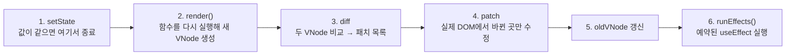

# Mini React: Virtual DOM부터 Hooks까지 직접 구현

> React가 화면을 어떻게 "필요한 곳만" 고치는지 궁금해서, 라이브러리 없이 Vanilla JavaScript로 **Virtual DOM → Diff → Patch**와 **함수형 컴포넌트 · useState · useEffect · useMemo**를 직접 만들었습니다.

| | |
|---|---|
| **기간** | 2026-11-07 ~ 2026-11-11 |
| **담당** | 이강현 (개인 구현) |
| **기술** | HTML · CSS · JavaScript (ES Modules) · Node.js 22 · jsdom |
| **제약** | React, Vue 등 UI 프레임워크 사용 금지 |
| **코드** | `src/` 구현, `tests/` 테스트 (총 101개) |

과제 요구사항은 [MISSION.md](../MISSION.md), 협업 규칙은 [CONTRIBUTING.md](../CONTRIBUTING.md)를 따릅니다.

## 1. 결과물

실행 방법은 아래 [7번](#7-설치실행테스트)에 있습니다.

### Phase 1. Virtual DOM · Diff · Patch · State History (`src/app/index.html`)

테스트 영역(편집 가능)에서 HTML을 수정하고 **Patch**를 누르면, 이전 Virtual DOM과 비교해 바뀐 부분만 실제 영역에 반영합니다. 뒤로가기/앞으로가기로 이전 상태를 되돌리고, 제목 옆의 `2/3`은 "현재 몇 번째 VDOM / 전체 몇 개"를 뜻합니다.

### Phase 2. 세 개의 Hook으로 만든 할 일 앱 (`src/app/todo.html`)

상태와 Hook은 루트 `App`에서만 쓰고, 자식 컴포넌트(`TodoItem`, `Filters` 등)는 props만 받는 순수 함수로 만들었습니다. 입력 중에도 입력창 DOM이 유지되고, 완료 토글이나 삭제 때 바뀐 부분만 patch됩니다.

- `useState`: 할 일, 입력값, 필터, 경과 시간
- `useMemo`: 남은 개수와 필터된 목록 (deps가 바뀔 때만 계산)
- `useEffect`: `document.title` 갱신, `setInterval` 시계와 cleanup

### 학습용 데모. 카드 뒤집기 + "DOM 보기" 패널 (`tests/game_test/index.html`)

"내가 만든 diff와 patch가 정말 바뀐 곳만 고치는가"를 눈으로 확인하려고 만든 메모리 카드 게임입니다. 카드를 누르면 패널에 그 업데이트의 과정이 단계별로 나옵니다.

- `2 / 41`: 전체 노드 41개 중 **2개만** 바뀜 (카드의 `class`와 글자)
- 단계별 과정: setState → render → diff → patch → effect
- 패치 카드: 이전 값은 빨간 취소선, 새 값은 초록색으로 표시
- hooks 배열 표: 이번에 바뀐 칸(`flipped`, effect의 deps)을 노란색으로 표시
- 패치된 실제 DOM 요소는 600ms 동안 하이라이트

## 2. 핵심 설계

### 클릭 한 번이 화면에 반영되기까지



실제 DOM을 건드리는 곳은 4번 `patch` 하나뿐입니다. `diff`는 DOM에 접근하지 않는 순수 함수라 테스트하기 쉽습니다.

### VNode

```js
{ type: "button", props: { class: "card", onClick: fn }, children: ["?"] }   // 글자는 문자열
```

### Diff: 두 VNode를 비교해 패치 목록을 만든다

카드 한 장을 뒤집으면 이렇게 됩니다.

```text
이전 VNode                     새 VNode                          diff가 만든 패치 (2개)
<div class="board">            <div class="board">
  <button class="card">          <button class="card flipped">   PROPS [1,0]    class: card → card flipped
    "?"                            "🐶"                          TEXT  [1,0,0]  ? → 🐶
  <button class="card">          <button class="card">
    "?"                            "?"
```

`path`는 루트에서 `children` 번호를 따라가는 길입니다. `[]`는 루트, `[1,0]`은 루트의 1번째 자식(board)의 0번째 자식(첫 카드)입니다. patch는 이 길을 따라 DOM 노드를 찾아 해당 속성·글자만 고치므로 나머지 노드는 같은 객체로 남습니다.

| op | 언제 | patch가 하는 일 |
|---|---|---|
| `TEXT` | 둘 다 글자인데 내용이 다름 | `textContent`만 교체 |
| `PROPS` | 같은 태그인데 속성이 다름 | 바뀐 속성만 `set` / `remove` |
| `CREATE` | 새 자식이 더 많음 | 부모 끝에 새 노드 추가 |
| `REMOVE` | 새 자식이 더 적음 | 노드 삭제. 인덱스가 밀리지 않게 **큰 번호부터** |
| `REPLACE` | 태그가 다르거나 글자↔태그 | 통째로 새로 만들어 교체 |

### State: 값은 함수 밖의 `hooks` 배열에 산다

컴포넌트 함수는 렌더할 때마다 처음부터 다시 실행되어 지역 변수가 사라집니다. 그래서 값을 컴포넌트 객체의 `hooks` 배열 칸에 저장하고, **Hook을 부른 순서가 곧 칸 번호**가 되게 했습니다. 훅을 조건문 안에서 쓰면 안 되는 이유가 여기서 나옵니다.

```js
const [count, setCount] = useState(0);   // hooks[0]
const [name,  setName ] = useState("a"); // hooks[1]
// render()가 시작될 때마다 hookIndex = 0 으로 되돌린다
```

- `setState(next)`: `Object.is`로 같으면 렌더하지 않음 → 다르면 즉시 `update()`
- `useEffect`: 렌더 중에는 **예약만** 하고, DOM 반영 뒤에 실행. 실행 전에 이전 cleanup 호출
- `useMemo`: 렌더 중에 즉시 계산, deps가 같으면 이전 값(같은 참조) 반환

## 3. 문제를 만나고 해결한 기록

| 문제 | 원인 | 해결 |
|---|---|---|
| patch가 엉뚱한 노드를 고칠 수 있음 | HTML의 줄바꿈 공백 텍스트 노드를 `domToVNode`가 버려서 `childNodes` 인덱스와 VNode 인덱스가 어긋남 | 로드 시 실제 영역도 VNode로 다시 그려 두 구조를 일치시킴 |
| 클릭 핸들러가 patch마다 중복 실행 | 리스너를 patch할 때마다 새로 붙임 | 요소마다 핸들러 저장소를 두고 리스너는 이름마다 한 번만 등록. 저장소의 최신 함수를 호출 |
| 입력 중 커서가 끝으로 튐 | 같은 값을 `el.value`에 다시 대입 | 값이 이미 같으면 대입하지 않음 |
| 문자열 `onclick="..."` 위험 | 속성을 그대로 `setAttribute` | `on*`는 함수일 때만 이벤트로 받고 문자열은 무시 |
| 체크박스 테스트에서 change가 안 옴 | 문서에 연결되지 않은 요소는 jsdom이 이벤트를 발생시키지 않음 | 테스트 컨테이너를 `document.body`에 붙임 |
| 카드 한 장 뒤집는데 패치가 18개 | 클릭 함수가 렌더마다 새로 만들어져 모든 버튼에 `PROPS` 발생 | 패널에서 "함수만 바뀐 패치"를 구분해 제외하고 개수를 따로 표시 |
| 패널의 effect deps가 `배열 1개`로 뭉개져 보임 | 값 표시 함수가 중첩 배열까지 줄여 버림 | 테스트로 잡고 객체 배열만 줄이도록 수정 |

## 4. 테스트

단위·기능 테스트를 Vitest 형식으로 작성했고, DOM은 jsdom으로 검증합니다. 기대값을 구현 출력에 맞추지 않고 요구사항 기준으로 작성했습니다.

| 영역 | 파일 | 개수 |
|---|---|---|
| Diff | `tests/diff.test.js` | 8 |
| Patch (diff→patch 왕복, 노드 재사용 포함) | `tests/patch.test.js` | 15 |
| History | `tests/history.test.js` | 7 |
| FunctionComponent | `tests/component.test.js` | 7 |
| useState | `tests/use_state.test.js` | 10 |
| useEffect | `tests/use_effect.test.js` | 10 |
| useMemo | `tests/use_memo.test.js` | 9 |
| 이벤트 · props | `tests/events.test.js` | 9 |
| 할 일 앱 | `tests/todo.test.js` | 9 |
| 카드 게임 · 패널 | `tests/game_test/game.test.js` | 17 |
| **합계** | | **101** |

- 현재 환경에 Vitest가 설치되어 있지 않아, `describe`/`test`/`expect`를 흉내 내는 임시 러너로 위 101개가 모두 통과하는 것을 확인했습니다. Vitest로는 아직 실행하지 못했고, `npm test`는 `vitest` import 때문에 실패합니다.
- jsdom 검증은 실제 브라우저의 reflow/repaint를 대신하지 않아서, 화면 기능은 브라우저에서도 직접 확인했습니다.

## 5. 한계와 다음 단계

- **key 없이 index로 비교**: 목록 앞을 지우면 뒤 항목을 하나씩 덮어쓰고 마지막을 지웁니다. `key` 기반 비교로 노드를 재사용해 옮기는 것이 다음 목표입니다.
- **batching 없음**: `setState`마다 바로 재렌더합니다. 여러 변경을 모아 한 번에 처리하도록 개선할 수 있습니다.
- **effect 동기 실행**: 실제 React는 화면을 그린 뒤 비동기로 실행합니다.
- **핸들러 PROPS가 매번 생김**: 렌더마다 새 함수라서 비용은 작지만 불필요한 패치가 생깁니다.
- 실제 React와의 차이: Fiber(작업 중단·재개), 합성 이벤트, 동시성 모드는 구현하지 않았습니다.

## 6. 구조

```text
src/
  vdom/        domToVNode, vnodeToDom, props(속성·이벤트 적용)
  diff/        diff
  patch/       patch
  history/     State History
  component/   FunctionComponent
  hooks/       useState, useEffect, useMemo, 현재 컴포넌트 추적, deps 비교
  app/         Phase 1 화면(index.html), 할 일 앱(todo.html)
tests/         단위·기능 테스트, game_test/ (카드 게임과 DOM 보기 패널)
```

## 7. 설치·실행·테스트

저장소 루트에서 실행합니다.

```sh
npm --prefix LeeKangHyun ci
npm --prefix LeeKangHyun run dev
```

| 화면 | 주소 |
|---|---|
| Phase 1 (Diff · Patch · History) | http://localhost:5173/src/app/index.html |
| 할 일 앱 | http://localhost:5173/src/app/todo.html |
| 카드 게임 + DOM 보기 | http://localhost:5173/tests/game_test/index.html |

AI 검증을 요청할 때는 저장소 루트 기준 `/verify LeeKangHyun/src/diff`처럼 담당 폴더를 명시합니다. 공용 안내는 [CLAUDE.md](../CLAUDE.md), 검증 절차는 [verify 스킬](../.claude/skills/verify/SKILL.md)을 확인합니다.

## 8. 개발 방식

단계마다 작은 단위로 구현하고 테스트로 검증하는 방식으로 진행했으며, AI 코딩 도구(Claude Code)와 협업했습니다. 핵심 로직(diff의 비교 규칙, patch의 노드 탐색, hooks 배열과 `hookIndex`, 의존성 비교)은 직접 설명할 수 있도록 정리했습니다.

## 진행 상황

- [x] Phase 1: Virtual DOM · Diff · Patch · State History
- [x] Phase 2: FunctionComponent · useState · useEffect · useMemo
- [x] 입력·클릭에 반응하는 데모와 단위·기능 테스트
- [x] 핵심 로직 설명과 실제 React와의 차이 정리 (위 2번, 5번)

## 작업 기록 (시간순)

시각은 git 커밋 시간 기준이며, 커밋 전에 만든 작업은 마지막 수정 시간을 적었습니다. 새 작업을 할 때마다 아래에 날짜·시각·커밋과 변경 내용을 이어서 적습니다.

### 2026-11-07 20:44 · `d4a208e`: 폴더 이름 변경
- 개인 폴더 이름을 `member-03`에서 `LeeKangHyun`으로 변경.

### 2026-11-07 21:45 · `313d4e8`: domToVNode
- `src/vdom/vdom_create.js`: 실제 DOM을 VNode(`{ type, props, children }`, 글자는 문자열)로 변환하는 `domToVNode` 작성. 공백만 있는 텍스트와 주석은 제외.

### 2026-11-09 10:52 · `e0946a2`: vnodeToDom
- `src/vdom/vdom_create.js`: VNode를 새 실제 DOM 요소로 만드는 `vnodeToDom` 추가. 기존 DOM은 건드리지 않고 diff도 하지 않음.

### 2026-11-09 17:15 · `7d0fa7e`: 페이지 뼈대
- `src/app/index.html`: 실제 영역(`#real-area`), 테스트 영역(`#test-area`, contenteditable), Patch·뒤로가기·앞으로가기 버튼.
- `src/app/main.js`: 로드 시 실제 영역을 VNode로 변환해 테스트 영역에 렌더링.
- `src/vdom/vdom_create.js`: 두 함수를 `export`하고 최상위 실행 코드를 제거(import 가능하게).

### 2026-11-09 20:35 · `e69329e`: diff
- `src/diff/diff.js`: `diff(oldVNode, newVNode)` 추가. DOM 없이 patch 배열 반환(`REPLACE`, `TEXT`, `PROPS`, `CREATE`, `REMOVE`). `REMOVE`는 인덱스 내림차순. key 비교는 하지 않음.
- `tests/diff.test.js`: Vitest 형식 테스트 8개 작성.

### 2026-11-09 22:58 · `ed3acb2`: patch와 Patch 버튼 연결
- `src/diff/patch.js`(이후 `src/patch/`로 이동): `patch(rootDom, patches)` 추가. path를 따라 노드를 찾아 5가지 op를 적용하고, 노드가 없으면 에러를 던지며, 루트가 교체되면 새 루트를 반환.
- `src/app/main.js`: 로드 시 실제 영역도 VNode로 다시 그려 `childNodes` 인덱스를 VNode와 맞춤. Patch 버튼은 테스트 영역 읽기 → diff → patch → `oldVDOM` 갱신. 테스트 영역이 비면 alert, 변경이 없으면 아무것도 하지 않음.
- `tests/patch.test.js`: 테스트 15개 작성(op 5종, 중첩, 에러, diff→patch 왕복, 노드 재사용).

### 2026-11-10 19:20 · `108d5ca`: State History
- `src/history/history.js`: `createHistory`(`push`, `back`, `forward`, `canBack`, `canForward`, `current`). 뒤로 간 뒤 새로 저장하면 앞쪽 기록을 삭제. DOM에 의존하지 않는 순수 모듈.
- `src/app/main.js`: 뒤로/앞으로 이동 시 실제 영역은 diff·patch로 바뀐 곳만 반영하고 테스트 영역은 다시 그림. 이동할 수 없으면 버튼 `disabled`. 제목 옆에 `현재/전체` VDOM 순서(`3/3`) 표시.
- `tests/history.test.js`: 테스트 7개 작성.

### 2026-11-10 21:47 · `9819ab5`: FunctionComponent
- `src/component/function_component.js`: 함수형 컴포넌트를 감싸는 클래스. `hooks`, `hookIndex`, `render()`(VNode가 아니면 에러), `mount(container)`, `update()`(diff→patch 재사용, mount 전이면 에러).
- `tests/component.test.js`: 테스트 7개 작성.

### 2026-11-10 22:09 · `440774f`: useState
- `src/hooks/use_state.js`: `useState(initial)`. 상태는 `hooks[hookIndex]` 슬롯에 저장하고 `setState`는 슬롯당 한 번만 생성(렌더 간 `===`). `Object.is`로 같으면 렌더하지 않고, 다르면 즉시 `update()`. 함수형 업데이트 지원. 렌더 밖 호출·렌더 도중 `setState`는 에러.
- `tests/use_state.test.js`: 테스트 10개 작성.

### 2026-11-11 15:00 · `942d143`: useEffect
- `src/hooks/current_component.js`: 현재 렌더 중인 컴포넌트 추적을 `use_state.js`에서 분리(순환 import 없음).
- `src/hooks/use_effect.js`: `useEffect(effect, deps)`. 렌더 중에는 예약만 하고 DOM 반영 뒤에 실행. 실행 전에 이전 cleanup 호출.
- `src/component/function_component.js`: `pendingEffects`, `runEffects()`, `unmount()` 추가(effect는 동기 실행, 실제 React는 페인트 뒤 비동기).
- `src/diff/patch.js`를 `src/patch/patch.js`로 이동.
- `tests/use_effect.test.js`: 테스트 10개 작성.

### 2026-11-11 15:09 · `7c5f3fb`: useMemo
- `src/hooks/deps.js`: deps 비교 `depsChanged`를 `useEffect`와 `useMemo`가 같이 쓰도록 분리.
- `src/hooks/use_memo.js`: `useMemo(factory, deps)`. 렌더 중 즉시 계산하고 deps가 같으면 이전 값(같은 참조) 반환. factory가 예외를 던지면 캐시하지 않음.
- `patch.js` 이동에 따라 옛 경로를 쓰던 import(`main.js`, `function_component.js`, 테스트 2개)를 수정.
- `tests/use_memo.test.js`: 테스트 9개 작성.

### 2026-11-11 15:18 · `9115490`: 이벤트(onClick 등)와 props 적용
- `src/vdom/props.js`: `setProp`/`removeProp`. `on`+대문자이고 값이 함수이면 이벤트로 처리(요소마다 핸들러 저장소를 두고 리스너는 이름마다 한 번만 등록해 patch를 반복해도 중복 실행되지 않음). 문자열 `onclick="..."`은 보안상 무시.
- `value`, `checked`는 DOM 프로퍼티로 설정. `false`/`null`/`undefined`는 속성 제거, `true`는 빈 문자열 attribute.
- `vnodeToDom`과 `patch`의 `PROPS` 처리가 `props.js`를 같이 사용. `vnodeToDom`은 `<select value>`가 먹히도록 자식을 먼저 붙인 뒤 props 적용.
- `tests/events.test.js`: 테스트 9개 작성.

### 2026-11-11 21:09 · `85262ee`: 할 일 앱, 카드 게임과 "DOM 보기" 패널
- 할 일 앱(`src/app/todo.html`, `todo_main.js`, `todo_app.js`): 상태·훅은 루트 `App`에서만 쓰고 자식은 순수 함수. `useState`, `useMemo`, `useEffect`(제목 갱신, `setInterval` 시계와 cleanup) 사용. `props.js`는 `value`가 이미 같으면 대입하지 않도록 수정(입력 중 커서 보존). `tests/todo.test.js` 9개.
- 카드 게임과 "DOM 보기" 패널(`tests/game_test/` 안에서만 작업): 4x4 메모리 카드 게임. `FunctionComponent`를 상속해 `update()`를 재정의하여 diff 결과를 가로채고, 패치된 실제 DOM 요소를 하이라이트.
- 패널: 업데이트 기록 선택, 한눈에 보기, 단계별 과정(setState→render→diff→patch→effect), 패치 카드(위치 설명과 이전→새 값), hooks 배열 표(바뀐 칸 강조), VNode 트리. `tests/game_test/game.test.js` 17개.

### 2026-11-12: README를 포트폴리오로 정리
- README 상단에 결과물, 핵심 설계, 문제 해결 기록, 테스트 현황을 정리하고 작업 기록의 시각을 git 커밋 시간 기준으로 바로잡음. 빠져 있던 patch · History · FunctionComponent · useState 기록을 채움.

### 검증 메모
- 실행한 검증: Vitest가 설치되어 있지 않아 임시 러너(`describe`/`test`/`expect`를 흉내 내는 스크립트)로 전체 테스트 파일(101개)을 실행해 모두 통과를 확인. Vitest로는 실행하지 못했고, `npm test`는 `vitest` import 때문에 실패함.
- 알려진 제한: diff는 key 없이 index로 비교, 핸들러는 렌더마다 새 함수라 `PROPS` 패치가 매번 생김, batching 없음, effect는 동기 실행.
