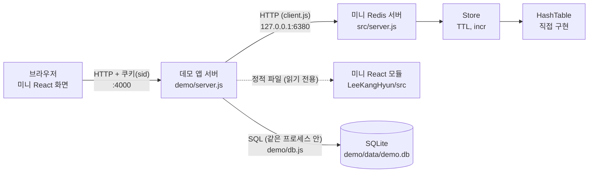

# 미니 Redis

> `Map`도 `Object`도 쓰지 않고 해시 테이블부터 직접 만든 Node.js 인메모리 키-값 저장소. 만료(TTL), 무효화, 원자적 증가를 구현하고, REST API 서버와 클라이언트를 붙인 뒤, 이것을 "외부에서 쓰는" 로그인 세션 데모(직접 만든 미니 React 화면)까지 연결했습니다. 대시보드의 원본 데이터는 진짜 SQL DBMS(SQLite)에서 읽어서, Redis 캐시를 쓸 때와 쓰지 않을 때의 응답 시간을 [직접 재서 비교](#성능-벤치마크-redis-사용-vs-미사용)했습니다. 외부 라이브러리는 하나도 쓰지 않았습니다.

| | |
|---|---|
| **환경** | Node.js (ESM), 외부 라이브러리 없음. 개발·테스트는 Node `v26.13.0`에서 실행 |
| **현재 단계** | 4단계: 성능 벤치마크 (완료) |
| **테스트** | `node:test` 134개 통과 (아래 [테스트 결과](#8-테스트-결과) 참고) |

## 0. 전체 구조

미니 Redis는 독립된 서버이고, 데모 앱 서버가 HTTP로 호출합니다. **브라우저는 미니 Redis를 직접 호출하지 않고** 데모 앱 서버만 호출합니다 (세션 id와 저장소를 브라우저에 노출하지 않기 위해).



| 파일 | 역할 |
|---|---|
| `src/hash_table.js` | `Map`/`Object` 없이 직접 만든 해시 테이블 (버킷 배열 + 체이닝) |
| `src/store.js` | 해시 테이블 위의 저장소 (TTL, 만료, `incr`) |
| `src/server.js` | 미니 Redis REST API 서버 (`createApp`) |
| `src/client.js` | 미니 Redis를 호출하는 `fetch` 기반 클라이언트 |
| `demo/server.js` | 데모 앱 서버: 로그인·세션·대시보드 API와 정적 파일 (`createDemoApp`) |
| `demo/auth.js` | 비밀번호 해시·검증, 세션 id 생성, 쿠키 파싱 |
| `demo/seed_users.js`, `demo/users.json` | 테스트 계정 생성 스크립트와 그 결과(해시만 저장) |
| `demo/db.js` | 대시보드 원본 데이터 계층: `node:sqlite`로 SQLite를 열고 `getDashboardStats(username)`를 제공 (데이터 출처의 경계) |
| `demo/seed_db.js` | 벤치마크용 SQLite DB 생성 스크립트 (`npm run seed:db`) |
| `demo/web/` | 미니 React로 만든 화면 (`index.html`, `app.js`, `style.css`)과 통계 모듈 `stats.js` (화면과 벤치마크 CLI가 같이 씀) |
| `bench/benchmark.js` | 성능 벤치마크 CLI (`npm run bench`). 결과는 `bench/results/`에 저장 |
| `tests/*_test.js` | 단위·통합 테스트. 이름을 `*_test.js`로 한 이유는 `node --test`는 찾지만 루트의 Vitest 기본 패턴(`*.test.js`)에는 잡히지 않게 하려는 것 |

## 1. 실행 방법

```sh
cd LeeKangHyun/redis
npm run seed     # 1) 테스트 계정 생성 (demo/users.json). 이미 있으면 건너뛰어도 됨
npm run seed:db  # 2) 대시보드용 SQLite DB 생성 (demo/data/demo.db, 30만 행). DB_INDEX=on 이면 인덱스도 만듦
npm start        # 3) 미니 Redis 서버: http://127.0.0.1:6380
npm run demo     # 4) 데모 앱 서버: http://127.0.0.1:4000   (터미널을 하나 더 열어서 실행)
npm test         # 테스트 134개 (DB 파일은 임시 폴더에 만들고 끝나면 지움)
npm run bench -- --spawn   # 성능 벤치마크 (아래 [성능 벤치마크](#성능-벤치마크-redis-사용-vs-미사용) 참고)
```

`npm run demo`는 SQLite DB가 없으면 `npm run seed:db를 먼저 실행하세요`라는 안내를 출력하고 종료 코드 1로 끝납니다.

브라우저에서 **http://127.0.0.1:4000** 을 열고 아래 계정으로 로그인합니다.

| 아이디 | 비밀번호 |
|---|---|
| `demo` | `demo1234` |
| `alice` | `alice1234` |

이 계정은 **로컬 데모용 테스트 값**입니다. 실제 비밀번호를 쓰지 않으며, `users.json`에는 비밀번호가 아니라 scrypt 해시와 사용자별 salt만 저장됩니다.

| 환경변수 | 대상 | 기본값 | 설명 |
|---|---|---|---|
| `PORT` | 각 서버 | 미니 Redis `6380`, 데모 `4000` | 포트가 이미 사용 중이면 안내 메시지를 내고 종료 코드 1로 끝난다 (아래 [문제 해결](#문제-해결)) |
| `HOST` | 각 서버 | `127.0.0.1` | 인증이 없는 미니 Redis가 외부 인터페이스에 노출되지 않도록 기본은 `127.0.0.1`에만 연다 |
| `REDIS_URL` | 데모 | `http://127.0.0.1:6380` | 미니 Redis 주소 |
| `SESSION_TTL_MS` | 데모 | 1800000 (30분) | 세션 유효 시간 |
| `DASHBOARD_DELAY_MS` | 데모 | `0` | 인위적인 지연. **이제 기본은 지연 없이 진짜 SQL 조회**이고, 느린 원본을 흉내 내고 싶을 때만 쓴다 |
| `DASHBOARD_CACHE_TTL_MS` | 데모 | 30000 | 대시보드 캐시 유효 시간 |
| `DEMO_DB_PATH` | 데모, 시드 | `demo/data/demo.db` | SQLite DB 파일 경로 |
| `SEED_ROWS` | `npm run seed:db` | 300000 | 만들 `events` 행 수 |
| `DB_INDEX` | `npm run seed:db` | `off` | `on`이면 `username` 인덱스를 만든다 (어느 쪽으로 시드했는지 DB의 `meta` 테이블에 남겨 앱과 벤치마크가 읽는다) |

데모 앱은 시작할 때 `REDIS_URL`의 `/health`를 한 번 호출해서 정말 미니 Redis인지 확인합니다. 아니면 경고를 출력하지만 서버는 계속 켜 둡니다 (미니 Redis를 나중에 켜도 동작하도록).

### 문제 해결

**포트 충돌: VS Code의 Live Preview 확장이 3000번(HTTP)과 3001번(WebSocket)을 쓰고 있을 수 있습니다.** 이 프로젝트의 미니 Redis를 처음에 3000번으로 켰다가 실제로 겪은 문제입니다. 그래서 기본 포트를 `6380`으로 바꿨습니다.

| 증상 | 원인 | 해결 |
|---|---|---|
| `포트 N이 이미 사용 중입니다. PORT 환경변수로 다른 포트를 지정하세요` 출력 후 종료 | 그 포트를 다른 프로그램이 이미 사용 중 | 안내대로 다른 포트를 지정: `PORT=6381 npm start` (PowerShell: `$env:PORT=6381; npm start`) |
| 데모 앱 시작 시 `미니 Redis가 아닌 서버가 응답하고 있습니다 (주소/포트 확인)` 경고, 로그인하면 `503 session store unavailable` | `REDIS_URL`의 포트를 미니 Redis가 아닌 다른 프로그램(예: Live Preview의 404 HTML이나 `426 Upgrade Required` 응답)이 쓰고 있음 | 미니 Redis를 다른 포트로 켜고 같은 주소를 데모에 알려 줌: `PORT=6381 npm start`, `REDIS_URL=http://127.0.0.1:6381 npm run demo` |
| 데모 앱 시작 시 `미니 Redis에 연결할 수 없습니다` 경고 | 미니 Redis가 켜져 있지 않음 | 먼저 `npm start`로 미니 Redis를 켬 |
| 포트 3000/3001을 누가 쓰는지 모를 때 | - | Windows: `netstat -ano \| findstr :3000`, 마지막 열이 프로세스 id |

저장소만 라이브러리처럼 쓸 수도 있습니다.

```js
import { Store } from "./src/store.js";

const store = new Store();
store.set("session:42", { user: "kim" }, 30_000);  // 30초 뒤 만료
store.get("session:42");                           // { user: "kim" }
store.ttl("session:42");                           // 남은 ms (만료 없으면 -1, 없으면 -2)
store.incr("page:views");                          // 1
```

## 2. 저장소 명령

| 명령 | 설명 | 반환 |
|---|---|---|
| `set(key, value, ttlMs?)` | 값 저장. `ttlMs`가 없으면 만료 없음이고, 덮어쓰면 이전 ttl은 사라짐 | - |
| `get(key)` | 값 조회. 만료됐으면 그 자리에서 삭제 (lazy expiration) | 값 또는 `undefined` |
| `del(key)` | 삭제 | 지웠으면 `true` |
| `exists(key)` | 존재 여부 (만료된 키는 없는 것으로 봄) | `boolean` |
| `expire(key, ttlMs)` | 기존 키에 만료 시간 설정 | 성공 여부 |
| `ttl(key)` | 남은 시간 | 남은 ms, 만료 없음 `-1`, 키 없음/만료 `-2` |
| `incr(key)` | 1 증가 (없거나 숫자가 아니면 0에서 시작) | 증가 후 값 |
| `size()` | 만료되지 않은 항목 수 | 숫자 |
| `sweep()` | 만료 항목을 한꺼번에 정리 (active expiration) | 지운 개수 |
| `startSweeper(ms)` / `stopSweeper()` | `sweep()`을 주기적으로 실행 / 중지 | - |

값은 JSON으로 직렬화할 수 있는 것(문자열, 숫자, 객체, 배열, `null`)만 허용합니다. 키는 비어 있지 않은 문자열이어야 하고, 잘못된 키는 `TypeError`, 잘못된 ttl은 `RangeError`입니다.

## 3. 미니 Redis HTTP API

모든 응답은 JSON(`Content-Type: application/json`)입니다. 키는 URL 경로에 들어가므로 인코딩해서 보냅니다 (`a/b` → `a%2Fb`, 한글·공백도 가능).

| 메서드 | 경로 | 요청 본문 | 성공 응답 | 상태 코드 |
|---|---|---|---|---|
| `PUT` | `/keys/:key` | `{ "value": any, "ttlMs": number? }` | `{ key, ttlMs }` (`ttlMs`가 없으면 `null`) | 새로 만듦 `201`, 덮어씀 `200` |
| `GET` | `/keys/:key` | - | `{ key, value, ttlMs }` (`ttlMs`는 남은 ms, 만료 없으면 `null`) | `200`, 없거나 만료 `404` |
| `DELETE` | `/keys/:key` | - | `{ deleted: true }` | `200`, 없으면 `404` |
| `POST` | `/keys/:key/expire` | `{ "ttlMs": number }` | `{ key, ttlMs }` | `200`, 키 없음 `404` |
| `GET` | `/keys/:key/ttl` | - | `{ key, ttlMs }` (`-1`은 만료 없음) | `200`, 키 없음/만료 `404` |
| `POST` | `/keys/:key/incr` | - | `{ key, value }` | `200` |
| `GET` | `/stats` | - | `{ size }` (만료 항목 제외) | `200` |
| `GET` | `/health` | - | `{ status: "ok" }` | `200` |

| 오류 상태 | 경우 |
|---|---|
| `400` | 잘못된 JSON, 객체가 아닌 본문, `value` 누락, `ttlMs`가 양수가 아님, 빈 키, 512자 초과 키, 잘못된 퍼센트 인코딩 |
| `404` / `405` | 없는 경로 / 지원하지 않는 메서드 (`Allow` 헤더 포함) |
| `413` | 본문이 1MB 초과 |
| `500` | 예상치 못한 예외. 응답은 항상 `{ "error": "internal error" }`이고 메시지나 스택은 노출하지 않음 (로거에만 전달) |

`OPTIONS`는 CORS 프리플라이트로 `204`를 돌려줍니다.

```sh
curl -X PUT http://127.0.0.1:6380/keys/greeting -H 'Content-Type: application/json' -d '{"value":"hello","ttlMs":30000}'
# {"key":"greeting","ttlMs":30000}                       → 201
curl http://127.0.0.1:6380/keys/greeting
# {"key":"greeting","value":"hello","ttlMs":29960}        → 200
curl -X POST http://127.0.0.1:6380/keys/counter/incr
# {"key":"counter","value":1}
```

### 클라이언트 (`src/client.js`)

`new MiniRedisClient({ baseUrl, timeoutMs = 2000 })`는 `set(key, value, ttlMs?)`, `get(key)`(없으면 `undefined`), `del(key)`(`boolean`), `expire(key, ttlMs)`(`boolean`), `ttl(key)`(없으면 `-2`), `incr(key)`를 제공합니다. 키는 `encodeURIComponent`로 인코딩하고 타임아웃은 `AbortSignal.timeout`으로 겁니다. 에러는 세 종류로 구분합니다.

| 에러 | 언제 |
|---|---|
| `RedisHttpError` (`status` 포함) | 서버가 4xx/5xx로 응답 (404는 "없음"이라는 정상 결과라 에러가 아님) |
| `RedisUnavailableError` | 연결할 수 없음 |
| `RedisTimeoutError` (위의 하위 종류) | 제한 시간 안에 응답이 없음 |

## 4. 로그인 세션 데모

### 세션 흐름

```mermaid
sequenceDiagram
    participant B as 브라우저 (미니 React)
    participant D as 데모 앱 서버
    participant R as 미니 Redis
    B->>D: POST /api/login {username, password}
    D->>R: GET login_fail:<username> (잠금 확인)
    D->>D: scrypt 검증 (없는 아이디도 같은 계산)
    D->>R: PUT session:<sid> {username, createdAt} + TTL 30분
    D-->>B: 200 + Set-Cookie sid=<sid>; HttpOnly; SameSite=Lax
    B->>D: GET /api/me (쿠키 자동 전송)
    D->>R: GET session:<sid>, POST expire (TTL 갱신)
    D-->>B: 200 {username, expiresInMs}
    B->>D: POST /api/logout
    D->>R: DELETE session:<sid>
    D-->>B: 200 + Set-Cookie sid=; Max-Age=0
```

| 메서드 | 경로 | 설명 | 상태 코드 |
|---|---|---|---|
| `POST` | `/api/login` | `{ username, password }` → 쿠키 발급, 응답 `{ username }` | `200`, 입력 오류 `400`, 자격 증명 오류 `401`, 잠금 `429`(+`Retry-After`), 저장소 장애 `503` |
| `GET` | `/api/me` | 세션 조회와 TTL 갱신, 응답 `{ username, expiresInMs }` | `200`, 세션 없음 `401` |
| `POST` | `/api/logout` | 세션 삭제와 쿠키 제거. 세션이 없어도 성공 (멱등) | `200` |
| `GET` | `/api/dashboard?mode=db\|redis` | 로그인 필요. `mode`를 안 주면 `redis`. 응답 `{ data, source: "redis"\|"db", elapsedMs }`와 `X-Source`, `X-Cache` 헤더. 예전의 `?cache=off`는 `mode=db`와 같은 뜻 | `200`, 알 수 없는 `mode` `400`, `401` |
| `DELETE` | `/api/dashboard/cache` | 로그인한 사용자의 캐시 삭제 (무효화) | `200`, `401` |

- **세션**: id는 `crypto.randomBytes(32)`(hex 64자)이고, 미니 Redis에 `session:<id>` → `{ username, createdAt }`을 TTL(기본 30분)과 함께 저장합니다.
- **sliding expiration**: 인증이 필요한 요청이 성공할 때마다 `expire`로 TTL을 다시 30분으로 늘리고 쿠키의 `Max-Age`도 같이 갱신합니다.
- **로그인 시도 제한**: 실패할 때마다 `login_fail:<username>`을 `incr`하고, 값이 1이면 5분 만료를 겁니다. 5회 실패 뒤에는 `429`와 `Retry-After`로 막고, 잠금 중에는 비밀번호가 맞아도 거절합니다. 로그인에 성공하면 카운터를 지웁니다. 존재하지 않는 아이디에도 똑같이 적용합니다.
- **대시보드 (진짜 SQL 조회 + cache-aside 캐시)**: 원본은 SQLite의 `events` 테이블 집계입니다 (`SELECT type, COUNT(*), SUM(amount) FROM events WHERE username = ? GROUP BY type`, prepared statement로 값을 바인딩). `mode=db`는 매번 SQL을 실행합니다(`X-Source: db`, `X-Cache: BYPASS`). `mode=redis`는 `cache:dashboard:<username>`을 먼저 조회해 있으면 즉시 응답(`X-Source: redis`, `X-Cache: HIT`), 없으면 SQL을 실행하고 30초 TTL로 저장합니다(`X-Source: db`, `X-Cache: MISS`). 두 모드는 같은 내용의 `data`를 돌려줍니다. `elapsedMs`는 `performance.now()` 기준 소수 둘째 자리까지입니다. 키에 사용자 이름이 들어가서 다른 사용자의 캐시가 섞이지 않습니다.
- **SQLite 조회는 동기 호출**(`node:sqlite`의 `DatabaseSync`)이라 실행되는 동안 이 서버의 다른 요청이 기다립니다. 벤치마크의 동시성 결과를 읽을 때 중요합니다.

```sh
curl -i -c jar.txt -X POST http://127.0.0.1:4000/api/login -H 'Content-Type: application/json' -d '{"username":"demo","password":"demo1234"}'
curl -b jar.txt http://127.0.0.1:4000/api/me
curl -b jar.txt -i http://127.0.0.1:4000/api/dashboard                  # 기본 redis 모드: 첫 요청 X-Cache: MISS, 두 번째 HIT
curl -b jar.txt -i "http://127.0.0.1:4000/api/dashboard?mode=db"        # 매번 SQL 조회 (X-Source: db, BYPASS)
curl -b jar.txt -X DELETE http://127.0.0.1:4000/api/dashboard/cache
curl -b jar.txt -X POST http://127.0.0.1:4000/api/logout -H 'Content-Type: application/json' -d '{}'
```

### 화면 (미니 React)

`demo/web/app.js`는 직접 만든 미니 React(`FunctionComponent`, `useState`, `useEffect`)로 작성했고, 서버가 `/mini-react/*` 경로로 상위 폴더의 `src/`를 읽기 전용으로 제공해 브라우저가 모듈을 import합니다. 상태와 Hook은 루트 `App`에서만 쓰고 자식 컴포넌트(`LoginForm`, `Welcome`, `DashboardPanel`)는 props만 받는 순수 함수입니다.

- 로그인 폼 (`label`과 `input` 연결, 오류는 `role="alert"`, 로그인 중 버튼 비활성화)
- 로그인 후: 환영 문구, 세션 남은 시간 카운트다운, 로그아웃, 대시보드 영역
- `useEffect`: 처음 로드할 때 `/api/me`로 로그인 상태 복구, 1초 타이머(`setInterval`과 cleanup), 남은 시간이 0이 되면 서버에 확인해서 401이면 "세션이 만료되었습니다" 안내
- 대시보드 **데이터 출처 선택**: `[DBMS 직접 (SQLite)]` / `[Redis 캐시 + DBMS]` 두 버튼 중 하나만 켜집니다 (`role="radiogroup"`, `aria-checked`). 아래에 "Redis 캐시 모드에서도 캐시에 값이 없으면 DBMS를 읽습니다. DBMS 직접 모드는 매번 SQL을 실행합니다."라는 설명이 있습니다.
- "대시보드 불러오기"(선택한 모드로 호출해 출처, HIT/MISS, 걸린 시간 ms를 소수 둘째 자리까지 표시), "캐시 지우기", 최근 응답 시간 목록
- **"벤치마크 실행"**: 브라우저에서 두 모드를 각각 30회 순서대로 호출해 평균·중앙값·p95를 표와 막대로 보여 줍니다. DBMS는 첫 1회를 워밍업으로 빼고, Redis는 시작 전에 캐시를 한 번 지워서 첫 호출(MISS)을 따로 보여 줍니다. 실행 중에는 버튼이 비활성화되고 진행 상황이 표시됩니다. 막대는 CSP가 인라인 `style`을 막아서 `<div>` 너비 대신 `<meter>` 요소로 그렸습니다. **이 화면의 수치는 브라우저에서 잰 참고용이고, 공식 수치는 `npm run bench`로만 잽니다.**

## 성능 벤치마크 (Redis 사용 vs 미사용)

처음에는 "Redis를 안 쓸 때"를 `setTimeout`으로 만든 가짜 지연으로 흉내 냈는데, 이러면 "50ms가 3ms로"처럼 내가 정한 숫자가 그대로 결과가 되어 과장될 수 있습니다. 그래서 원본을 **진짜 SQL DBMS**로 바꿔서 비교했습니다. Node 26에 내장된 `node:sqlite`(SQLite)를 쓰기 때문에 설치한 것이 없습니다.

### 무엇을 어떻게 쟀나

- **측정 대상**: 데모 앱의 `GET /api/dashboard`. 측정 프로그램(`bench/benchmark.js`)이 데모 계정으로 로그인한 뒤 HTTP로 요청하고, 응답 본문을 다 받을 때까지의 시간(왕복 시간)을 `performance.now()`로 잽니다.
- **데이터**: `events` 테이블(`id, username, type, amount, created_at`) 300,000행. 고정 시드의 의사난수로 만들어서 같은 명령이면 항상 같은 데이터입니다. 사용자는 8명(`demo`, `alice` 등)이라 사용자 한 명이 전체의 약 12.5%(`demo`는 37,627행)입니다.
- **쿼리**: `SELECT type, COUNT(*) AS cnt, SUM(amount) AS total FROM events WHERE username = ? GROUP BY type`. 쿼리 플랜을 확인했습니다: 인덱스가 없으면 `SCAN events`(전체 읽기), 있으면 `SEARCH events USING INDEX idx_events_username (username=?)`.
- **워밍업 20회는 통계에서 제외**하고, 측정 요청은 200회입니다. 보고 항목은 평균, 중앙값(p50), p95, p99, 최소·최대, 처리량(req/s)입니다.
- **같은 구성으로 4번씩** 반복해서 측정하고, 아래 표는 **4번의 중앙값**입니다. 한 번만 재면 우연한 흔들림이 결과가 되기 때문입니다.
- **인덱스 없음(`DB_INDEX=off`)과 있음(`DB_INDEX=on`) 두 구성**으로 각각 쟀습니다. 인덱스가 있으면 DBMS도 빨라져서 Redis의 이득이 줄기 때문에, 한쪽만 재면 결론이 한쪽으로 기웁니다.

| 시나리오 | 무엇을 재나 |
|---|---|
| (a) DBMS 직접 | `?mode=db`: 매 요청마다 SQL 실행 |
| (b) Redis 캐시 HIT | `?mode=redis`: 캐시에 값이 있는 상태 (워밍업이 캐시를 채움) |
| (c) Redis 캐시 MISS | 요청마다 캐시를 지운 뒤 `?mode=redis`: SQL 조회에 Redis 조회와 저장이 더해진 비용 (지우는 시간은 재지 않음). 동시에 여러 요청이 오면 다른 요청이 캐시를 채워 버려서 MISS가 보장되지 않으므로 동시성 1에서만 잼 |
| (d) 동시성 | (a)와 (b)를 동시 요청 1개와 20개로 측정 |

### 측정 환경

| 항목 | 값 |
|---|---|
| 측정 일시 | 2026-11-13 10:31~10:37 (KST) |
| 명령 | `DB_INDEX=off npm run seed:db` 또는 `DB_INDEX=on npm run seed:db` 다음에 `node bench/benchmark.js --spawn` (기본값: 요청 200, 워밍업 20, 동시성 1과 20) |
| Node / OS | v26.13.0 / Windows 11 (10.0.26200) x64 |
| CPU | Intel Core Ultra 5 115U, 10코어 |
| DB | SQLite 3.54.0, 30만 행, 파일 약 9MB(인덱스 없음), 인위적 지연 `DASHBOARD_DELAY_MS=0` |
| 구성 | 측정 프로그램, 데모 앱, 미니 Redis가 모두 같은 컴퓨터(`127.0.0.1`)의 서로 다른 프로세스 |
| **측정 중 상태** | **다른 프로그램(로컬 LLM 서버)이 CPU를 많이 쓰고 있었습니다.** 측정 직후 확인한 전체 CPU 사용률이 74~78%였습니다. 아래 "한계" 참고 |

### 결과 (ms, 4번의 중앙값)

**인덱스 없음 (`DB_INDEX=off`)**

| 시나리오 | 동시성 | 평균 | p50 | p95 | p99 | 처리량 (req/s) | 서버 내부 p50 |
|---|---:|---:|---:|---:|---:|---:|---:|
| DBMS 직접 | 1 | 28.14 | 27.63 | 32.24 | 36.27 | 36 | 24.92 |
| DBMS 직접 | 20 | 526.75 | 529.44 | 673.20 | 682.05 | 36 | 25.34 |
| Redis 캐시 HIT | 1 | 1.63 | 1.42 | 3.11 | 4.17 | 618 | 0.24 |
| Redis 캐시 HIT | 20 | 13.35 | 12.77 | 21.00 | 22.23 | 1506 | 3.20 |
| Redis 캐시 MISS | 1 | 30.75 | 29.53 | 38.77 | 43.35 | - | 28.04 |

**인덱스 있음 (`DB_INDEX=on`)**

| 시나리오 | 동시성 | 평균 | p50 | p95 | p99 | 처리량 (req/s) | 서버 내부 p50 |
|---|---:|---:|---:|---:|---:|---:|---:|
| DBMS 직접 | 1 | 23.50 | 22.16 | 33.77 | 38.24 | 43 | 19.48 |
| DBMS 직접 | 20 | 400.18 | 410.43 | 486.31 | 505.06 | 48 | 19.34 |
| Redis 캐시 HIT | 1 | 1.97 | 1.61 | 3.79 | 5.68 | 509 | 0.29 |
| Redis 캐시 HIT | 20 | 14.89 | 11.46 | 35.53 | 43.26 | 1323 | 2.39 |
| Redis 캐시 MISS | 1 | 22.46 | 21.51 | 27.84 | 34.71 | - | 20.32 |

`서버 내부 p50`은 데모 앱이 응답에 담아 준 `elapsedMs`의 중앙값으로, HTTP 왕복을 뺀 서버 안의 조회 시간입니다. "-"는 구하지 않은 값입니다(MISS는 요청마다 캐시 삭제 호출이 끼어서 처리량을 못 구함).

**4번 각각의 평균 (동시성 1, ms)**: 흔들림이 얼마나 큰지 보여 주려고 그대로 적습니다.

| 구성 | 시나리오 | 1회 | 2회 | 3회 | 4회 |
|---|---|---:|---:|---:|---:|
| 인덱스 없음 | DBMS 직접 | 28.15 | 27.53 | 33.00 | 28.13 |
| | Redis HIT | 1.40 | 1.83 | 2.92 | 1.43 |
| | Redis MISS | 28.07 | 32.93 | 34.50 | 28.57 |
| 인덱스 있음 | DBMS 직접 | **73.16** | 22.65 | 22.30 | 24.35 |
| | Redis HIT | **6.96** | 2.14 | 1.80 | 1.36 |
| | Redis MISS | **61.70** | 21.91 | 22.78 | 22.13 |

### 해석

- **Redis 캐시 HIT은 DBMS 직접 조회보다 훨씬 빨랐습니다.** 평균 기준으로 인덱스가 없을 때 28.14ms → 1.63ms(약 17배), 인덱스가 있을 때 23.50ms → 1.97ms(약 12배)입니다. 이 차이는 가짜 지연 없이 진짜 SQL 조회와 비교한 값입니다.
- **인덱스를 만들면 격차가 줄었습니다.** 인덱스로 DBMS가 28.14ms → 23.50ms(약 17% 빠름)가 되어서 Redis의 이득이 17배에서 12배로 줄었습니다. 다만 줄어든 폭이 생각보다 작은데, 사용자가 8명뿐이라 한 사용자의 행이 전체의 12.5%(약 3.8만 행)여서 **인덱스가 행을 거의 걸러 주지 못하기** 때문입니다. 사용자가 훨씬 많아서 쿼리가 소수의 행만 읽는 경우에는 DBMS가 훨씬 빨라지고 Redis의 이득도 더 크게 줄 것으로 예상하지만, 이것은 **측정하지 않은 추측**입니다.
- **캐시 MISS는 이득이 없습니다.** MISS는 SQL 조회에 Redis 조회(실패)와 저장이 더해진 경로입니다. 서버 안의 조회 시간(p50)이 DBMS 직접보다 인덱스 없음 24.92ms → 28.04ms(+3.1ms), 인덱스 있음 19.48ms → 20.32ms(+0.8ms)로 늘었습니다. 클라이언트에서 잰 평균으로 MISS와 DBMS 직접의 차이를 반복마다 구하면(크게 흔들린 인덱스 있음 1회는 뺀 7번) -2.2~+5.4ms 사이로 매번 달랐고, 이 흔들림은 반복 측정 사이의 차이(위 표)와 비슷한 크기라서 **정확한 MISS 추가 비용을 숫자 하나로 말할 수는 없습니다.** 확실한 것은 MISS가 DBMS 직접보다 빠르지 않다는 점이고, 캐시 이득은 HIT 비율에서 나옵니다.
- **동시 요청이 20개일 때 DBMS 직접은 평균 지연이 약 19배로 늘고(28 → 527ms) 처리량은 그대로입니다(36 req/s).** 이것은 SQLite 조회(`DatabaseSync`)가 동기 호출이라 데모 앱의 이벤트 루프를 막고, 요청들이 한 줄로 서서 차례로 처리되기 때문입니다. 즉 이 수치는 "DBMS가 동시성에 약하다"가 아니라 **"단일 스레드 Node 서버에서 동기 DB 호출을 쓴 이 구현의 특성"**입니다. 비동기 클라이언트로 접속하는 DBMS에서는 다르게 나올 수 있습니다. 반대로 Redis 캐시 HIT은 비동기 HTTP 호출이라 20개 동시에서도 평균 13.35ms, 처리량 1506 req/s로 늘었습니다.

### 한계 (읽을 때 꼭 알아야 할 것)

1. **미니 Redis는 HTTP/JSON입니다.** 요청마다 HTTP 요청과 JSON 변환의 오버헤드가 있어서, 실제 Redis(RESP 프로토콜, 소켓 직접 통신)와 **직접 비교할 수 없습니다.** 서버 안에서 캐시 HIT을 처리하는 시간(위 표의 서버 내부 p50, 0.24~0.29ms)이 곧 데모 앱에서 미니 Redis를 HTTP로 한 번 호출하는 비용이고, 그 안에 HTTP 처리와 JSON 변환이 들어 있습니다. 실제 Redis의 RESP로는 이 부분이 달라질 수 있습니다. (실제 Redis로는 측정하지 않았습니다.)
2. **SQLite는 같은 프로세스 안에서 도는 임베디드 DB입니다.** 네트워크 왕복이 없어서, MySQL/PostgreSQL처럼 클라이언트-서버 구조의 DBMS보다 조회가 빠르게 나옵니다. 그런 DBMS에서는 DBMS 직접 조회가 더 느려지고 Redis의 이득이 더 커질 수 있습니다. (측정하지 않았습니다.)
3. **인덱스가 있으면 격차가 줄어듭니다.** 위 결과대로입니다. 그리고 이 데이터는 사용자가 8명뿐이라 인덱스 효과가 작은 편입니다. 쿼리와 데이터 모양에 따라 결과가 크게 달라집니다.
4. **캐시 MISS는 DBMS 단독보다 느립니다.** 정확하게는 "빠르지 않고, 서버 내부 시간으로는 0.8~3.1ms 더 걸렸습니다." 캐시를 도입했는데 HIT 비율이 낮으면 오히려 손해입니다.
5. **캐시는 TTL 동안 오래된 값을 줄 수 있습니다.** 원본(DB)이 바뀌어도 캐시가 만료되거나 `DELETE /api/dashboard/cache`로 지울 때까지 이전 값이 나갑니다. 속도와 최신성을 맞바꾸는 것이고, 무효화를 직접 해야 합니다.
6. **한 대의 개발 PC에서 쟀고, 측정 중 다른 프로그램이 CPU의 약 75%를 쓰고 있었습니다.** 측정 프로그램, 데모 앱, 미니 Redis도 같은 컴퓨터에서 CPU를 나눠 씁니다. 그래서 **절대 수치가 아니라 상대 비교로 읽어야 합니다.** 위 4번 각각의 평균을 보면 인덱스 있음 1회는 평소의 약 3배(DBMS 직접 73ms, MISS 62ms)로 튀었는데, 이런 흔들림을 줄이려고 중앙값을 썼습니다. 또 측정 중에 다른 곳에서 띄운 것으로 보이는 `npm start`, `npm run demo` 프로세스(미니 Redis와 데모 앱)도 켜져 있었습니다. 요청이 없는 상태라 CPU를 거의 쓰지 않았을 것으로 보지만 확인하지는 않았습니다. 컴퓨터가 한가한 상태에서 다시 재면 숫자가 달라질 수 있습니다.
7. 데이터는 30만 행, 사용자 8명, 쿼리 하나로 만든 인공 데이터입니다. 실제 서비스의 데이터와 접근 패턴(어떤 키가 얼마나 자주 읽히는지)을 대표하지 않습니다.
8. 처리량(req/s)은 측정 프로그램과 서버가 같은 컴퓨터에서 도는 조건의 값입니다.

### 다시 재는 방법

```sh
npm run seed:db                      # DB_INDEX=off (기본)
npm run bench -- --spawn             # 서버를 직접 띄워서 측정 (결과는 bench/results/ 에 JSON과 Markdown으로 저장)

DB_INDEX=on npm run seed:db          # 인덱스를 만들어서 다시 시드
npm run bench -- --spawn
```

옵션은 `--requests <n>`(기본 200), `--warmup <n>`(기본 20), `--concurrency 1,20`, `--db <파일>`, `--out <폴더>`, `--no-save`입니다. `--spawn`을 빼면 이미 떠 있는 데모 앱(`--demo-url`, 기본 `http://127.0.0.1:4000`)과 미니 Redis를 대상으로 잽니다. 한 번만 재지 말고 여러 번 재서 중앙값을 보세요. 결과 파일(`bench/results/`)과 DB 파일(`demo/data/`)은 생성물이라 `.gitignore`로 git에서 뺐습니다.

## 5. 보안 설계와 한계

| 항목 | 설계 | 한계 |
|---|---|---|
| 쿠키 | `HttpOnly`(스크립트에서 못 읽음), `SameSite=Lax`, `Path=/`, `Max-Age` | 데모가 로컬 HTTP라서 **`Secure`를 붙이지 않았습니다.** 운영에서는 HTTPS와 `Secure`가 필요 |
| 비밀번호 | 평문 저장 금지. `crypto.scrypt` + 사용자별 랜덤 salt, 비교는 `timingSafeEqual` | 데모 계정 2개뿐이고 가입·변경 기능은 없음 |
| 계정 열거 | 틀린 비밀번호와 없는 아이디가 같은 `401 invalid credentials`. 없는 아이디에도 가짜 계정으로 같은 해시 계산 | 응답 시간이 완전히 같다고 보장하지는 않음 (시간을 측정해 검증하지는 않았음) |
| 무차별 대입 | 5회 실패 시 5분 잠금 (`429`) | 아이디 기준이라 한 계정을 일부러 잠그는 공격은 가능. IP 기준 제한은 없음 |
| CSRF | `POST`는 `application/json`만 받아(아니면 `415`) HTML 폼 전송을 막고, `SameSite=Lax`와 함께 사용 | CSRF 토큰은 없음 |
| 세션 id | 암호학적 난수 32바이트. 쿠키 값이 64자 hex가 아니면 저장소를 조회하지 않고 `401` | 로그인 때 세션을 새로 발급하지만 기존 세션을 일괄 폐기하는 기능은 없음 |
| 저장소 장애 | 미니 Redis에 닿지 못하면 인증을 통과시키지 않고 `503` (**fail closed**) | 장애 동안 로그인된 사용자도 사용 불가 |
| 미니 Redis 노출 | 인증이 없어서 기본 `127.0.0.1`에만 바인딩. 브라우저는 직접 호출하지 않음 | 미니 Redis 자체에는 인증·권한이 없음. `HOST`를 바꾸면 노출됨 |
| 정적 파일 | 정해진 두 폴더만, 허용된 확장자만 제공. `..`, `%2e%2e`, `%2f`, 백슬래시, NUL, `:` 등을 거절하고 심볼릭 링크로 밖을 가리키는 경우도 막음. `nosniff`와 CSP 헤더 | - |
| 오류 응답 | 모두 JSON이고 내부 메시지·스택은 응답에 없음 | - |

## 6. 과제 요구사항별 대응

| 요구사항 | 구현 |
|---|---|
| 저장 / 조회 / 삭제 | `set` / `get` / `del`, HTTP `PUT` / `GET` / `DELETE /keys/:key` |
| 해시 테이블 직접 구현 | `src/hash_table.js` (체이닝, 적재율 0.75에서 rehash) |
| 만료 처리 | lazy expiration(읽을 때) + active expiration(`sweep`, 서버는 1초마다). 세션 30분, 로그인 잠금 5분, 대시보드 캐시 30초가 모두 TTL |
| API 구조 | REST API 서버(`src/server.js`)와 클라이언트(`src/client.js`), 이를 호출하는 데모 앱 서버 |
| 무효화 | `del`, `expire`, 로그아웃 시 세션 삭제, `DELETE /api/dashboard/cache` |
| 동시성 | 단일 스레드 이벤트 루프에서 동기 명령이라 원자적(`incr` 동시 200개 = 정확히 200). 여러 HTTP 호출을 묶은 경우는 원자적이지 않음 (아래 [동시성](#7-핵심-설계-해시-테이블-만료-동시성) 참고) |
| API 응답을 Redis에 저장해 활용 | `GET /api/dashboard`의 SQL 조회 결과를 캐시 (`X-Source`, `X-Cache` HIT/MISS/BYPASS). 사용/미사용 비교는 [성능 벤치마크](#성능-벤치마크-redis-사용-vs-미사용) |
| Redis 사용/미사용 성능 비교 | 진짜 SQL DBMS(SQLite)를 원본으로 두고 `npm run bench`로 측정. 인덱스 on/off 두 구성으로 비교 |
| 로그인 세션 (활용 사례) | `session:<sid>` 저장, sliding expiration, 로그인 시도 제한 |

## 7. 핵심 설계: 해시 테이블, 만료, 동시성

### 해시 테이블

키를 배열 칸 번호로 바꾸면 배열 접근 한 번으로 값을 찾을 수 있습니다. 이 "키 → 칸 번호" 변환이 해시 함수입니다.

```text
buckets (용량 4)
 [0] → null
 [1] → ["apple", 1] → ["melon", 7]      ← 같은 칸에 걸린 두 키 (충돌), 체인으로 연결
 [2] → ["kiwi", 3]
 [3] → null
```

- **해시 함수**: FNV-1a 32비트. 글자마다 `XOR` 후 소수를 곱해 섞습니다 (`Math.imul`로 32비트 곱셈). 칸 번호는 `해시 % 버킷 수`입니다.
- **충돌 처리 (체이닝)**: 서로 다른 키가 같은 칸에 걸릴 수 있으므로, 칸마다 `[key, value]` 목록을 두고 그 안에서 키를 직접 비교해 찾습니다. 생성자에 해시 함수를 주입할 수 있어서 테스트에서 `() => 0`으로 모든 키를 한 칸에 몰아 이 경로를 검증합니다.
- **rehash**: 항목 수 / 버킷 수(적재율)가 0.75를 넘으면 버킷 수를 2배로 늘립니다. 칸이 적으면 체인이 길어져 검색이 느려지기 때문입니다. 버킷 수가 바뀌면 `해시 % 버킷 수` 결과도 바뀌므로 **모든 항목을 새 칸에 다시 넣습니다**. 2배씩 늘리므로 비용을 나눠 보면 삽입 한 번당 평균 O(1)입니다.
- **키 제약**: 비어 있지 않은 문자열만 허용합니다 (아니면 `TypeError`). 키를 객체 속성이 아니라 배열 원소로 저장하기 때문에 `"__proto__"`, `"constructor"` 같은 키도 평범한 키로 동작하고 `Object.prototype`을 오염시키지 않습니다.

### 만료와 무효화

항목은 `{ value, expiresAt }`입니다. `value`는 JSON 문자열로 저장해서, 저장 뒤에 호출자가 객체를 바꿔도 저장소의 값은 변하지 않고 JSON으로 못 바꾸는 값(`undefined`, 함수)은 저장 전에 거절됩니다. 시계는 생성자에서 주입(`new Store({ now })`)해서 테스트에서 시간을 직접 움직입니다.

| 방식 | 언제 | 장점 / 단점 |
|---|---|---|
| **lazy expiration** | 읽는 순간(`get`, `exists`, `ttl`, `del`, `expire`) 만료를 확인하고 그 자리에서 삭제 | 비용이 읽을 때만 듦 / 아무도 읽지 않는 만료 항목이 메모리에 남음 |
| **active expiration** | `sweep()`이 만료 항목을 한꺼번에 정리하고 지운 개수를 반환. `startSweeper(ms)`가 `setInterval`로 주기 실행 | 안 읽는 항목도 치움 / 전체를 훑는 비용. 타이머는 `unref`해서 프로세스 종료를 막지 않음 |

무효화는 두 가지입니다. **`del`**은 원본이 바뀌는 순간 직접 지우는 가장 정확한 방법이고, **TTL**(`expire`, `set`의 `ttlMs`)은 직접 지우는 것을 놓쳐도 낡은 값이 영원히 남지 않게 하는 안전망입니다.

### 동시성

**Node는 단일 스레드 이벤트 루프라서, `await`나 콜백이 없는 동기 함수는 실행 도중에 다른 코드가 끼어들 수 없습니다.** 그래서 저장소의 모든 명령은 동기 함수로 만들었고 명령 안에 `await`를 넣지 않았습니다. 미니 Redis 서버에서는 요청 본문을 읽는 부분만 비동기이고, 그 뒤의 store 호출은 한 번에 끝납니다. 같은 키에 `POST /incr` 200개를 동시에 보내도 응답 값이 중복·유실 없이 1부터 200이고 최종 값이 200입니다 (`tests/server_test.js`).

**다만 이 원자성은 "한 번의 명령" 안에서만 성립합니다.** 데모 앱처럼 HTTP로 여러 번 호출해 묶으면 호출 사이에 다른 요청이 끼어들 수 있습니다. 대표적으로 로그인 실패 카운터의 `incr` → `expire`는 서로 다른 두 번의 HTTP 호출이라 원자적이지 않습니다.

- 두 호출 사이에 데모 앱이 멈추거나 연결이 끊기면 **만료 시간이 없는 카운터**가 남아 계정이 영구히 잠길 수 있습니다. 이를 완화하려고 실패할 때마다 카운터에 만료가 없으면(`ttl`이 `-1`) 다시 만료를 겁니다 (이 경로를 테스트로 확인). 이 방어도 호출을 한 번 더 늘릴 뿐이라 완벽한 해결은 아닙니다.
- 같은 아이디로 동시에 실패한 요청들이 서로 다른 시점에 `expire`를 거는 경쟁이 생길 수 있습니다. 실제로는 만료 시간이 약간 달라지는 정도입니다.
- 완전한 해결은 "증가와 만료 설정"을 하나의 명령으로 만드는 것입니다 (실제 Redis에서는 Lua 스크립트나 `SET ... EX`와 조합). 이 미니 Redis에는 그 명령이 없습니다.

**다중 스레드 환경이라면** 여러 스레드가 같은 해시 테이블을 동시에 건드리므로 락이 필요합니다. 테이블 전체에 락 하나(단순하지만 모든 명령이 줄을 섬), 버킷별 락(동시성이 높지만 `rehash`는 전체를 건드려 별도의 전체 락이나 점진적 rehash가 필요), `incr` 같은 "읽고 쓰기"는 락 안에서 한 덩어리로 하거나 CAS가 필요합니다. 실제 Redis도 명령 실행은 단일 스레드로 처리해서 이 문제를 피합니다.

## 8. 테스트 결과

`npm test` (Node `v26.13.0`): **134개 중 134개 통과, 실패 0개.** 저장소 테스트는 주입한 시계로 시간을 조작해서 실제로 기다리지 않고 만료를 검증합니다. 서버·데모 테스트는 포트 0으로 실제 서버를 띄워 HTTP 요청을 보내고, DB 테스트는 진짜 SQLite 파일을 임시 폴더에 만들어 쓴 뒤 지웁니다.

| 파일 | 개수 | 확인하는 것 |
|---|---|---|
| `tests/hash_table_test.js` | 13 | 기본 동작, 강제 충돌, 적재율 0.75 경계의 resize, 1만 2천 개 삽입 후 전부 조회, 특수 키, 잘못된 키 에러, FNV-1a 공개 테스트 벡터 |
| `tests/store_test.js` | 20 | 만료 전후 `get`, lazy expiration, `ttl` 세 가지 반환값, `expire`, 덮어쓰기 시 ttl 초기화, `incr`, `sweep`, `size`, 잘못된 ttl, sweeper |
| `tests/server_test.js` | 23 | 미니 Redis API의 상태 코드, ttl 만료, 특수 키, 400/413/405/404, CORS, 동시 `incr` 200개, 500 응답에 내부 정보 없음 |
| `tests/client_test.js` | 11 | 모든 메서드, 없는 키/삭제/ttl `-2`, 특수 키 인코딩, `RedisHttpError`, 타임아웃(`RedisTimeoutError`), 연결 불가(`RedisUnavailableError`) |
| `tests/demo_test.js` | 33 | 로그인과 쿠키 속성, `/me`(쿠키 없음, 이상한 쿠키는 저장소 미조회, 위조 sid), 로그아웃 멱등, 계정 열거 방지, 5회 실패 후 `429`와 `Retry-After`와 해제, 성공 시 카운터 초기화, 영구 잠금 방지, 세션 만료와 sliding, 대시보드 `mode=db`(매번 DB를 읽음)·`mode=redis`(MISS 후 HIT, HIT는 DB를 읽지 않음)·`?cache=off` 호환·알 수 없는 mode `400`·삭제 후 다시 MISS·TTL 후 MISS·사용자별 분리, `elapsedMs`가 소수 표현, 지연 옵션 기본값 0, 저장소 장애 시 `503`(fail closed), `415`, 정적 파일과 경로 이탈 21가지, 비밀번호 해시·쿠키 파싱·시드 스크립트 |
| `tests/db_test.js` | 11 | SQLite 쿼리 결과가 JS로 직접 계산한 값과 같음(모든 사용자와 없는 사용자), 시드(행 수·테이블 구조·메타·재현 가능성·재시드), `DB_INDEX` on/off(인덱스 존재와 같은 결과), SQL 인젝션 문자열이 값으로만 취급되고 테이블이 그대로임, 시드 안 된 DB의 안내와 빈 파일을 만들지 않음, 시드 스크립트 환경변수, DB가 없을 때 데모 앱의 안내와 종료 코드 1 |
| `tests/stats_test.js` | 9 | 알려진 배열의 평균·중앙값·p95·p99(nearest-rank), 정렬되지 않은 입력, 빈 배열, 20만 개 표본, 입력 불변 |
| `tests/bench_test.js` | 7 | 옵션 해석, Markdown 출력, `--spawn` 스모크 테스트(요청 수를 작게 해서 시나리오 5개를 재고 JSON·MD로 저장, 워밍업 제외, X-Cache 헤더 일치), `--no-save`, DB 없음과 잘못된 옵션의 종료 코드 1 |
| `tests/startup_test.js` | 7 | 실제 프로세스로 실행해서 포트 충돌 시 안내 메시지·스택 트레이스 없음·종료 코드 1(미니 Redis와 데모 둘 다), 미니 Redis 기본 포트 6380, 데모의 `REDIS_URL` 기본값, 시작 점검 `checkMiniRedis`(정상, 다른 프로그램이 응답하는 5가지 경우, 연결 불가, 응답 없음) |

### 직접 확인한 것

테스트와 별개로 두 서버를 실제로 띄워 확인했습니다. (처음 확인할 때는 미니 Redis를 `:3000`으로 띄웠고, 이후 기본 포트를 `:6380`으로 바꿨습니다. 데모는 `:4000`.)

- **curl**: 로그인 전 `/me` `401`, 틀린 비밀번호와 없는 아이디의 같은 `401`, 로그인 `200`과 `Set-Cookie`(`HttpOnly; SameSite=Lax; Path=/; Max-Age=1800`), `/me`, 대시보드 `MISS` → `HIT` → `?cache=off`의 `BYPASS`, 캐시 삭제 뒤 다시 `MISS`, `text/plain` 로그인의 `415`, 로그아웃과 그 뒤의 `/me` `401`, 정적 파일 `200`과 올바른 Content-Type, `/mini-react/../package.json`의 `404`.
- **브라우저 화면(미니 React, Claude 데스크톱 앱의 내장 브라우저에서 실행)**: 로그인 폼 표시, 틀린 비밀번호의 오류 문구, 로그인 후 환영 문구와 카운트다운(`30:00` → `29:58`), 대시보드 불러오기·캐시 사용 끄기·캐시 지우기와 응답 시간 목록, 새로고침 뒤 로그인 상태 복구, `SESSION_TTL_MS=4000`으로 띄웠을 때 만료 뒤 "세션이 만료되었습니다" 안내와 로그인 화면 복귀.
- **포트 변경 뒤 확인**: 기본값(`PORT` 없이) 그대로 `npm start`와 `npm run demo`를 켜서 로그인 `200`, `/me` `200`, 대시보드 `MISS` → `HIT`를 확인했고, 같은 포트로 두 서버를 한 번 더 켜면 안내 메시지와 종료 코드 1로 끝나는 것을 확인했습니다. 미니 Redis가 꺼져 있을 때의 `연결할 수 없습니다` 경고도 확인했습니다. `미니 Redis가 아닌 서버가 응답하고 있습니다` 경고는 실제 Live Preview로는 시험하지 못했고, 그 응답(404 HTML, `426`)을 흉내 낸 가짜 서버로 테스트에서 확인했습니다.
- **4단계(SQLite와 벤치마크) 확인**: 30만 행 시드(약 0.3~0.9초), 실제 서버 두 개를 띄운 브라우저 화면에서 "데이터 출처" 버튼이 하나만 켜지고 서로 바뀌는 것, 두 모드로 불러오기(예: DBMS 직접 약 24~27ms, 캐시 MISS 약 41ms 뒤 HIT 약 0.8ms로 소수점까지 표시), 캐시 지우기, "벤치마크 실행"을 눌렀을 때 진행 상황 표시·버튼 비활성화·표와 막대 표시, 그리고 CLI 벤치마크(`--spawn`)를 인덱스 없음 4번, 있음 4번 실행한 것까지 직접 확인했습니다. 이때 화면의 수치는 참고용이고 공식 수치는 위 [성능 벤치마크](#성능-벤치마크-redis-사용-vs-미사용)의 CLI 결과입니다.

### 확인하지 못한 것

- 브라우저 화면에서 **로그아웃 버튼을 직접 눌러 보지는 않았습니다** (로그아웃 API는 curl과 테스트로 확인).
- 내장 브라우저 한 종류에서만 확인했고, 다른 브라우저는 확인하지 않았습니다.
- `SIGINT`/`SIGTERM` 신호로 종료하는 경로는 개발 환경이 Windows라서 검증하지 못했습니다. 종료 로직인 `shutdown()`은 테스트했습니다.
- 응답 시간으로 계정 존재 여부가 드러나는지는 측정하지 않았습니다.
- 성능 벤치마크는 컴퓨터가 한가한 상태에서 재지 못했고(측정 중 다른 프로그램이 CPU를 많이 사용), 실제 Redis·MySQL·PostgreSQL과는 비교하지 않았습니다.
- 같은 이유로 여러 사용자 수나 다른 쿼리·데이터 모양에서는 재지 않았습니다. "인덱스가 더 선택적이면 격차가 더 줄 것"은 추측입니다.

## 9. 개발 기록 (설계 결정과 이유)

**1단계: 저장소 코어**
- **해시 테이블을 `[key, value]` 배열로 저장**: 키를 객체 속성으로 두면 `"__proto__"` 같은 키가 프로토타입을 건드립니다. 배열 원소로 두면 특수 키도 평범하게 처리됩니다.
- **값을 JSON 문자열로 저장**: 저장 뒤 호출자가 원본 객체를 바꿔도 저장소가 영향을 받지 않고, 저장할 수 없는 값은 저장 전에 거절됩니다. 대신 `NaN`은 `null`이 되고 `Date`는 문자열이 됩니다.
- **lazy와 active 만료를 함께 사용**: lazy만 쓰면 아무도 읽지 않는 항목이 메모리에 쌓이고, active만 쓰면 sweep 사이에 만료된 값을 읽게 됩니다.
- **시계와 해시 함수를 주입**: 테스트에서 실제로 기다리지 않고 시간을 움직이고, 충돌을 강제할 수 있습니다.

**2단계: HTTP API**
- **REST 방식**: 저장소의 명령이 "키 하나에 대한 동작"이라서 키를 자원(`/keys/:key`)으로, 동작을 HTTP 메서드(`PUT`/`GET`/`DELETE`)로 대응시켰습니다. 메서드와 상태 코드만 봐도 의미가 드러나고 `curl`로 바로 시험할 수 있습니다. 메서드로 표현하기 어려운 `expire`/`incr`는 하위 경로로 뒀습니다.
- **본문 크기를 1MB로 제한**: 제한이 없으면 큰 요청 하나가 서버 메모리를 다 쓸 수 있습니다. `Content-Length`가 이미 크면 본문을 읽지 않고 `413`을 돌려주고, 조각으로 오는 요청은 한도를 넘는 순간 저장을 멈춥니다.
- **CORS를 기본으로 열어 둠 (`*`)**: 다른 포트의 브라우저 화면이 호출할 수 있게 하려는 것입니다. 인증이 없는 서버라서 운영에서는 `corsOrigin`으로 좁혀야 합니다. (3단계에서는 브라우저가 데모 앱만 호출하므로 이 CORS는 쓰이지 않습니다.)
- **키를 `/`로 나눈 뒤에 디코딩**: 먼저 디코딩하면 `a%2Fb`가 경로를 쪼갭니다. URL 객체로 파싱하면 `..` 같은 키가 정규화로 사라지므로 원시 경로를 직접 자릅니다.
- **500은 항상 `internal error`**: 예외 메시지나 스택에는 내부 경로 같은 정보가 들어 있을 수 있어서 응답에 넣지 않고 로거로만 보냅니다.

**3단계: 로그인 세션 데모**
- **왜 브라우저가 미니 Redis를 직접 부르지 않는가**: 미니 Redis에는 인증이 없어서, 브라우저가 직접 부르면 누구나 `session:*` 키를 읽거나 만들 수 있습니다. 브라우저는 데모 앱 서버와만 통신하고, 데모 앱이 인증을 거친 뒤에만 Redis를 사용합니다. 그래서 세션 id도 `HttpOnly` 쿠키로만 다니고 화면의 스크립트가 볼 수 없습니다. 미니 Redis는 기본 `127.0.0.1`에만 바인딩합니다.
- **왜 sliding expiration인가**: 활동 중인 사용자가 30분 뒤 갑자기 로그아웃되지 않게 하려는 것입니다. 요청이 성공할 때마다 TTL을 다시 늘립니다. 단점은 계속 활동하면 세션이 영원히 이어진다는 점입니다. 대안인 **절대 만료**(로그인 시각부터 고정 시간 뒤 무조건 만료)는 탈취된 세션의 수명을 제한하는 데 더 안전해서, 운영에서는 sliding에 절대 상한을 함께 두는 것이 좋습니다. 이 데모는 단순함을 위해 sliding만 구현했고 `createdAt`을 저장해 둔 것은 그 상한을 나중에 붙일 수 있도록 하기 위해서입니다.
- **왜 fail closed인가**: 세션 저장소를 못 쓸 때 "일단 통과"시키면 장애가 곧 인증 우회가 됩니다. 불편하더라도 `503`으로 막는 쪽이 안전합니다. 로그아웃은 서버의 세션을 못 지워도 브라우저의 쿠키는 지우고 `503`을 돌려줍니다 (세션은 TTL로 저절로 사라집니다).
- **왜 `incr` + `expire`가 완벽한 원자적 연산이 아닌가**: 두 개의 HTTP 호출이라 사이에 실패하거나 다른 요청이 끼어들 수 있습니다. 영구 잠금을 막으려고 만료가 없는 카운터를 다시 고치는 방어를 넣었지만, 근본적인 해결은 증가와 만료 설정을 한 명령으로 묶는 것입니다. 미니 Redis에는 그런 명령이 없어서 한계로 남겼습니다.
- **로그인 실패를 아이디 기준으로 셈**: 없는 아이디에도 같은 규칙을 적용해야 잠금 여부로 계정 존재를 알아낼 수 없습니다. 대신 한 계정을 일부러 잠그는 공격이 가능합니다.
- **`415`로 `application/json`만 허용**: HTML 폼은 JSON 타입으로 전송할 수 없어서 단순한 CSRF 폼 전송이 막힙니다. `SameSite=Lax`와 함께 쓰는 보조 방어입니다.
- **정적 파일 서버를 직접 구현**: 외부 라이브러리를 쓰지 않는 조건 때문입니다. 경로를 `/`로 나눈 뒤 조각마다 디코딩해서 거르고(`%2e%2e`, `%2f`), 허용 확장자 목록과 실제 경로 비교(`realpath`)로 한 번 더 막습니다.
- **비동기 scrypt**: 동기 버전은 해시를 계산하는 동안 서버가 멈춰 다른 요청도 기다립니다.
- **1~2단계 코드는 동작을 바꾸지 않음**: 미니 Redis 서버는 기본 listen 주소를 `127.0.0.1`로 바꾼 것(`HOST`로 변경 가능)만 수정했습니다.
- **테스트를 만들다 겪은 일**: 클라이언트(`fetch`)가 `..`가 들어간 경로를 보내기 전에 정규화해서 경로 이탈 테스트는 원시 `http.request`로 보내야 했습니다. 또 `src/app/index.html`이 있어서 `/mini-react/app/`이 `200`인 것은 의도한 동작이라 테스트 기대값을 바로잡았습니다.

**3단계 후속: 포트 충돌 (기본 포트 3000 → 6380)**
- **원인**: 개발 PC에서 VS Code Live Preview 확장이 포트 3000(HTTP)과 3001(WebSocket, HTTP로 접속하면 `426 Upgrade Required`)을 쓰고 있었습니다. 미니 Redis를 3000으로 켜면 충돌했고, 데모 앱은 미니 Redis 대신 Live Preview의 404 HTML을 받아 로그인할 때 `503 session store unavailable`을 냈습니다. 같은 코드를 6380(미니 Redis)과 4100(데모)으로 직접 띄워 로그인, `/me`, 대시보드 MISS→HIT→BYPASS, 로그아웃, 정적 파일이 모두 정상인 것을 확인해서, 코드 문제가 아니라 포트 점유 문제로 판단했습니다.
- **결정 1 (기본 포트 6380)**: 3000번대는 개발 도구가 자주 쓰는 포트입니다. 6380은 실제 Redis의 기본 포트(6379)와 겹치지 않으면서 Redis 계열임을 알아보기 쉬워서 골랐습니다. `PORT`로 바꿀 수 있고 데모의 `REDIS_URL` 기본값도 같이 바꿨습니다.
- **결정 2 (포트 사용 중이면 안내 후 종료)**: `EADDRINUSE`는 스택 트레이스만 보이면 원인을 알기 어렵습니다. 원인과 해결 방법(`PORT` 지정)을 한 줄로 알려 주고 종료 코드 1로 끝냅니다. 미니 Redis와 데모 앱이 같습니다.
- **결정 3 (데모 시작 시 `/health` 점검)**: 포트 충돌은 "서버가 안 켜짐"이 아니라 "다른 프로그램이 응답함"으로 나타나서, 사용자에게는 이유를 알 수 없는 `503`으로만 보였습니다. 시작할 때 한 번 점검해서 응답이 `{ "status": "ok" }`가 아니면 경고를 냅니다. 서버는 계속 켭니다. 미니 Redis를 나중에 켜는 순서도 정상 사용법이기 때문입니다.

**4단계: 성능 벤치마크**
- **왜 SQLite인가**: 처음 비교는 `setTimeout`으로 흉내 낸 가짜 지연(50ms)이어서, 결과가 "내가 정한 지연 대 Redis 호출 시간"이 되어 과장될 수 있었습니다. 진짜 SQL DBMS를 원본으로 써야 정직한 비교가 됩니다. Node 26에 내장된 `node:sqlite`는 설치 없이 쓸 수 있고(외부 라이브러리 금지 조건에 맞음), 디스크 파일 기반이며, 대표적인 SQL DBMS입니다. 대신 임베디드라 네트워크 왕복이 없다는 점을 한계로 적었습니다.
- **왜 `getDashboardStats`를 경계로 두었나**: 데이터가 어디서 오는지를 `demo/db.js`의 함수 하나로 가둬서, 나중에 다른 DBMS(예: 직접 만든 미니 DBMS)로 바꿀 때 데모 앱 코드를 고치지 않고 같은 모양의 함수만 구현하면 됩니다. 결과에는 시각 같은 값을 넣지 않아서 `mode=db`와 `mode=redis`가 항상 같은 내용을 돌려줍니다.
- **왜 인덱스 on/off를 둘 다 쟀나**: 인덱스가 없는 "순진한 대시보드"만 재면 DBMS가 불리해서 Redis의 이득이 부풀려집니다. 인덱스가 있는 현실적인 DBMS와도 비교해야 결론이 정직합니다. 실제로 이 데이터에서는 인덱스 효과가 작았고(약 17%), 그 이유(사용자가 8명이라 선택도가 낮음)도 같이 적었습니다. 어느 쪽으로 시드했는지는 DB의 `meta` 테이블에 남겨서 앱과 벤치마크가 읽습니다.
- **왜 `elapsedMs`를 소수로 바꿨나**: 정수로 반올림하면 0.4ms인 캐시 HIT과 1ms 이하의 차이가 전부 0이나 1로 뭉개져서 3ms와 0.4ms의 차이가 보이지 않습니다. `performance.now()`로 재서 소수 둘째 자리까지 보여 줍니다.
- **왜 중앙값과 반복 측정인가**: 측정 중 컴퓨터에 다른 부하가 있어서 한 번의 평균은 크게 흔들렸습니다(인덱스 있음 1회는 평소의 3배). 평균 하나보다 중앙값(p50)과 p95/p99가 더 믿을 만하고, 같은 구성을 4번 재서 그 중앙값을 표에 썼습니다. 흔들린 값도 숨기지 않고 4번 각각을 적었습니다.
- **왜 MISS 시나리오는 동시성 1에서만 재나**: 여러 요청이 동시에 오면 한 요청이 캐시를 채우는 사이 다른 요청이 HIT가 되어 "MISS 비용"이 아닌 값이 섞입니다. 요청마다 캐시를 지우고 재는 방식은 순차 실행에서만 MISS를 보장합니다.
- **동시성 20에서 DBMS 처리량이 늘지 않는 이유를 따로 적은 이유**: 처음 결과(지연이 약 19배로 늘고 처리량 그대로)를 보고 "DBMS가 동시성에 약하다"고 읽기 쉬운데, 원인은 `DatabaseSync`가 동기 호출이라 단일 스레드 서버의 이벤트 루프를 막는 것이었습니다. 구현의 특성을 DBMS의 특성으로 오해하지 않도록 해석에 분명히 구분해서 썼습니다.
- **화면의 막대를 `<meter>`로 그린 이유**: 처음에는 `<div>` 너비를 비율로 주려고 했는데, 보안을 위해 넣은 CSP(`default-src 'self'`)가 스크립트가 만드는 인라인 `style` 속성을 막습니다. CSP를 풀지 않고, 값과 최댓값만 속성으로 주면 되는 `<meter>`로 같은 비교를 그렸습니다.
- **테스트를 만들다 겪은 일**: (1) 데모 앱이 시작할 때 DB부터 열게 되면서, 기본 DB가 없는 상태에서 데모를 띄우던 기존 시작 테스트 2개가 실패했습니다. 시작 테스트가 임시 시드 DB를 쓰도록 고쳤습니다. (2) DB 파일이 없을 때 `DatabaseSync`로 열면 빈 DB 파일이 새로 만들어져서 "시드가 안 됨"을 알아차리지 못할 수 있었습니다. 열기 전에 파일이 있는지 먼저 확인하고, 테스트로 "빈 파일을 만들지 않음"을 고정했습니다.
- **측정 중 겪은 일**: 같은 컴퓨터에서 다른 프로그램이 CPU를 많이 쓰고 있었고, 지난 단계에서 띄운 서버가 종료되지 않고 남아 있던 것도 발견해서 정리했습니다. 한가한 상태에서 다시 재지 못한 것은 한계로 남겼습니다.

## 10. 알려진 제한

- `size()`와 `sweep()`은 전체를 훑는 O(n)입니다. (실제 Redis는 만료 항목 표본을 뽑아 확인합니다.)
- 값은 JSON으로 바뀌므로 `NaN`은 `null`이 되고 `Date`는 문자열이 됩니다. 해시 테이블은 줄어들지 않습니다.
- `incr`은 숫자가 아닌 값을 0으로 취급합니다. (실제 Redis는 에러를 냅니다.)
- 미니 Redis 서버에는 인증·권한이 없고 CORS가 기본으로 열려 있습니다.
- 데모는 HTTP라서 `Secure` 쿠키를 쓰지 않았고, 세션에 절대 만료 상한이 없으며, 로그인 제한에 IP 기준이 없습니다.
- 대시보드의 SQLite 조회는 동기 호출이라 실행하는 동안 데모 앱의 다른 요청이 기다립니다. 벤치마크 수치는 [한계](#한계-읽을-때-꼭-알아야-할-것)대로 한 대의 PC, 인공 데이터, 임베디드 DB 조건에서 잰 것입니다.

## 11. 진행 상태

| 단계 | 상태 |
|---|---|
| 1. 해시 테이블과 저장소 코어 (TTL, 무효화, 원자적 `incr`) | 완료 |
| 2. HTTP API 서버 (REST, 에러 처리, CORS, 본문 제한) | 완료 |
| 3. 클라이언트와 로그인 세션 데모 (미니 React 화면, 대시보드 캐시) | 완료 |
| 4. Redis 사용/미사용 성능 비교 벤치마크 (진짜 SQL DBMS와 비교, 인덱스 on/off, 동시성 1·20) | 완료 (측정 수치와 한계는 [성능 벤치마크](#성능-벤치마크-redis-사용-vs-미사용)) |
| 5. 지속성 (디스크 저장) | 예정 |
