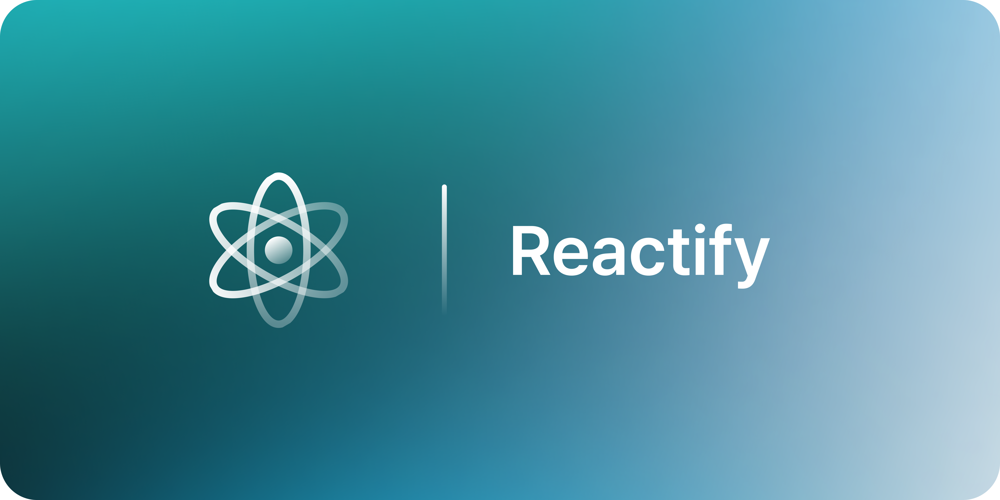

# Reactify
Vanilla JavaScript로 Virtual DOM → Diff → Patch부터 함수형 컴포넌트·State·Hooks까지 직접 구현하는 UI 라이브러리 프로젝트입니다.

HTML · CSS · JavaScript

> **개발 중** · 각자 독립 구현을 진행하며, 현재 구현·검증 상태는 개인 폴더의 README에서 확인합니다.

**구현 목표**

- **Phase 1** — Virtual DOM 변환, Diff·Patch를 통한 부분 업데이트와 상태 이력 탐색
- **Phase 2** — 함수형 컴포넌트와 `useState` · `useEffect` · `useMemo`

세 명이 각자의 폴더에서 전체 기능을 독립적으로 구현하고, 검증과 리뷰를 거쳐 최종 구현 하나를 선택합니다.

[프로젝트 미션](MISSION.md) · [협업 가이드](CONTRIBUTING.md)
